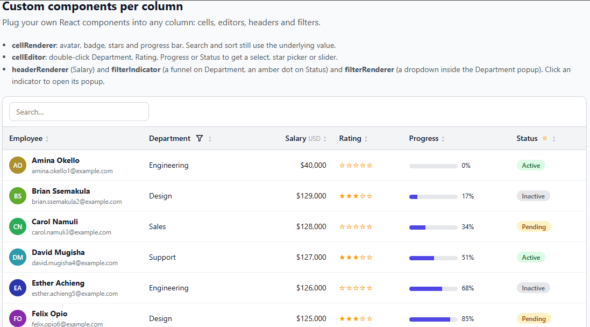
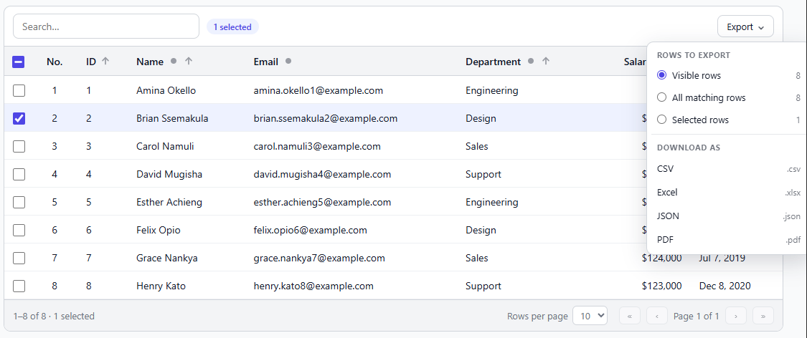
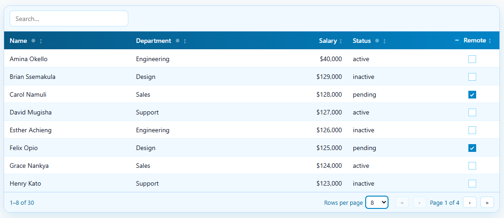
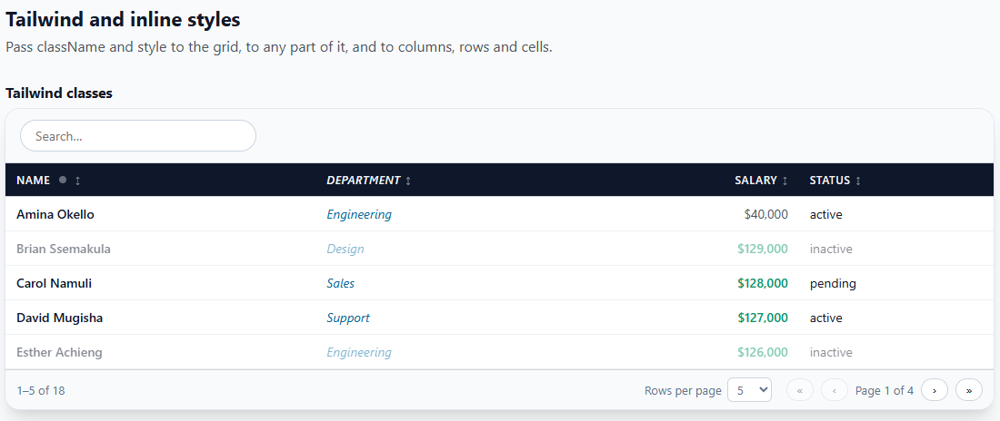

# React-gridix

A React `DataGrid` with row selection, server-side mode, typed per-column filters, date columns, in-cell editing, resizing and pinning, virtualization, export to CSV / Excel / JSON / PDF, 12 row animations, filter comparisons and 8 themes, plus the `Checkbox` it uses.

**Contents**

1. [Overview](#1-overview)
2. [Installation](#2-installation)
3. [Quick start](#3-quick-start)
4. [Theming](#4-theming)
5. [Checkbox](#5-checkbox)
6. [DataGrid](#6-datagrid)
7. [Demos](#7-demos)
8. [Troubleshooting](#9-troubleshooting)

---

## 1. Overview

| Component | Purpose |
| --- | --- |
| `DataGrid` | Data table with per-column sorting, search, typed per-column filters, pagination, in-cell editing, date columns, row selection, server-side mode, loading skeletons, resize / pin / hide, keyboard navigation, CSV export, virtualization, nested fields, striping, themes and custom column components |
| `Checkbox` | Checkbox in three looks (button with a span, tick, native), toggles with one click. The grid uses it for boolean columns and row selection, and you can use it on its own |

**Everything extra is opt-in.** A bare `<DataGrid columns={...} rows={...} />` is a plain read-only table. Sorting, the search box, page info, selection, resizing and the rest only appear when you switch them on:

| Feature | How you switch it on | Default |
| --- | --- | --- |
| Sorting | `sortable: true` **on a column** | off |
| Multi-column sort | `multiSort` on the grid | off |
| Global search box | `searchable` | off |
| Pagination bar (row count, page controls) | `pagination` | off |
| Column filter | `filterable: true` on a column | off |
| Editing | `editable` | off |
| Row selection | `rowSelection` | off |
| Server-side mode | `serverSide` | off |
| Resize / pin | `resizable: true` / `pinned` on a column | off |
| Show / hide columns button | `columnMenu` | off |
| Arrow-key navigation | `keyboardNavigation` | off |
| CSV export button | `exportable` | off |
| Virtualization | `virtualize` | off |
| Theme | `theme` | none (plain look) |

Everything is written in TypeScript, ships its own type definitions, and uses plain CSS (no CSS-in-JS runtime). The grid is 100% of its container's width by default. There is deliberately **no column reordering**.

Demo Display





---

## 2. Installation

**Requirements:** React 18 or newer and `react-dom`.

```bash
npm install react-gridix
```

The stylesheet is included in the package's `style.css`. Import it once, near the root of your app:

```tsx
import "react-gridix/style.css";
```

The library does not inject CSS by itself. If the grid looks unstyled, this import is missing.

**Optional: PDF export.** CSV, Excel (`.xlsx`) and JSON export need nothing extra. PDF export uses three small libraries. The grid does **not** import them (so your app builds and runs without them); you install them and hand them over, ideally through a function that imports them only when someone exports a PDF:

```bash
npm install jspdf jspdf-autotable        # the PDF itself and its table
npm install html2canvas                  # only if the PDF header / footer is a React element (it is drawn to a picture)
```

```tsx
<DataGrid
  exportable={{
    formats: ["csv", "pdf"],
    pdf: {
      libraries: async () => ({
        jsPDF: (await import("jspdf")).jsPDF,
        autoTable: (await import("jspdf-autotable")).default,
        html2canvas: (await import("html2canvas")).default,   // only for a header / footer element
      }),
    },
  }}
/>
```
Read more about stying pdf here [stying pdf here](https://github.com/simonbengtsson/jsPDF-AutoTable). Use the style property in `autoTableOptions` for styling cells

Adding `Header` and  `Footer` component 
```tsx
import logo from "./logo.png";

<DataGrid
  columns={columns}
  rows={rows}
  getRowId={(r) => r.id}
  exportable={{
    formats: ["pdf"],
    pdf: {
      libraries: async () => ({
        jsPDF: (await import("jspdf")).jsPDF,
        autoTable: (await import("jspdf-autotable")).default,
        html2canvas: (await import("html2canvas")).default,   // required for an element
      }),

      header: (
        <div style={{ display: "flex", alignItems: "center", gap: 12, borderBottom: "3px solid #4f46e5", paddingBottom: 6 }}>
          
          <div>
            <div style={{ fontSize: 20, fontWeight: 700, color: "#312e81" }}>Acme Corporation</div>
            <div style={{ fontSize: 12, color: "#6b7280" }}>People &amp; Culture report</div>
          </div>
        </div>
      ),

      footer: (
        <div style={{ textAlign: "center", fontSize: 11, color: "#6b7280" }}>
          Confidential. Do not share.
        </div>
      ),
    },
  }}
/>
``

Without `libraries`, or if an import fails, a PDF export reports an error that says what to install (see `onExportError`) and everything else keeps working.
```
---

## 3. Quick start

A read-only table, the smallest possible grid:

```tsx
import { DataGrid, type ColumnDef } from "react-gridix";
import "react-gridix/style.css";

interface Person { id: number; name: string; city: string }

const columns: ColumnDef<Person>[] = [
  { field: "id", headerName: "ID" },
  { field: "name", headerName: "Name" },
  { field: "city", headerName: "City" },
];

const rows: Person[] = [
  { id: 1, name: "Amina", city: "Kampala" },
  { id: 2, name: "Brian", city: "Nairobi" },
];

export default function App() {
  return <DataGrid columns={columns} rows={rows} />;
}
```

The same grid with the common features switched on:

```tsx
import { useState } from "react";
import { DataGrid, type ColumnDef } from "react-gridix";
import "react-gridix/style.css";

interface Person {
  id: number;
  name: string;
  joined: string; // "2026-03-14"
  contact: { email: string };
}

const columns: ColumnDef<Person>[] = [
  { field: "id", headerName: "ID", type: "number", editable: false, sortable: true },
  { field: "name", headerName: "Name", sortable: true, filterable: true },
  { field: "joined", headerName: "Joined", type: "date", sortable: true, filterable: true },
  { field: "contact.email", headerName: "Email" },
];

export default function App() {
  const [rows, setRows] = useState<Person[]>([
    { id: 1, name: "Amina", joined: "2026-03-14", contact: { email: "amina@example.com" } },
    { id: 2, name: "Brian", joined: "2025-11-02", contact: { email: "brian@example.com" } },
  ]);

  return (
    <DataGrid
      columns={columns}
      rows={rows}
      getRowId={(r) => r.id}
      editable
      onRowsChange={setRows}
      searchable          // search box
      pagination          // row count and page controls
      rowSelection        // checkbox column
      theme="ocean"
    />
  );
}
```

---

## 4. Theming

### 4.1 Built-in themes

Pass a theme name to the grid. **Without a `theme` prop nothing changes**: the grid keeps its plain default look.

```tsx
<DataGrid theme="midnight" ... />
```

| Theme | Look |
| --- | --- |
| `"ocean"` | Light, cool blues, blue gradient header, soft shadow |
| `"midnight"` | Dark slate, indigo accent, dark popups and inputs |
| `"sunset"` | Warm cream, burnt-orange-to-raspberry gradient header, serif font, rounded corners |
| `"forest"` | Calm greens, solid dark-green header, sharper corners |
| `"lavender"` | Light purple, deep violet gradient header, rounded corners |
| `"coffee"` | Warm browns and cream, serif font, rich brown header |
| `"graphite"` | Dark neutral grey with a teal accent, flat and sharp |
| `"aurora"` | Deep night blue with an emerald-to-blue-to-violet gradient header and a soft glow |

A theme is only a set of CSS variables on `[data-rg-theme="name"]`, written with `:where()` (zero specificity). So you can still override any variable or any class on top of a theme. Popups (the filter popup, the column menu) are drawn in `document.body`, and the grid copies the theme attribute onto them, so they follow the theme too.

**Switching themes at run time** is just a state change:

```tsx
const [theme, setTheme] = useState<GridTheme>("ocean");

<select value={theme} onChange={(e) => setTheme(e.target.value as GridTheme)}>
  {["ocean", "midnight", "sunset", "forest", "lavender", "coffee", "graphite", "aurora"].map((t) => (
    <option key={t}>{t}</option>
  ))}
</select>
<DataGrid theme={theme} ... />
```

**Following the system dark mode.** Choose the theme from a media query:

```tsx
const dark = window.matchMedia("(prefers-color-scheme: dark)").matches;
<DataGrid theme={dark ? "graphite" : "lavender"} ... />
```

**Tweaking a built-in theme.** Because themes have zero specificity, any variable or rule you write wins over them:

```css
/* make the aurora header a single colour */
[data-rg-theme="aurora"] { --rg-header-bg: #0f766e; }
```

**Making your own theme.** Any other string works as a theme name. Define the variables you want:

```css
[data-rg-theme="brand"] {
  --rg-header-bg: #7c3aed;
  --rg-header-text: #fff;
  --rg-row-hover: #f5f3ff;
  --rg-selected-bg: #ede9fe;     /* selected rows */
  --rg-primary: #7c3aed;
}
```

```tsx
<DataGrid theme="brand" ... />
```

A dark custom theme should also set the colours that the light defaults assume, for example `--rg-surface`, `--rg-text`, `--rg-border`, `--rg-pinned-bg`, `--rg-skeleton-a` and `--rg-skeleton-b`. Copy the `graphite` block in `themes.css` as a starting point.

### 4.2 CSS variables

Every variable is optional and is read with a fallback, so nothing is declared on the grid itself. Set them on `:root`, on any parent element, in your own theme, or in the grid's `style`.

| Variable | Default | Used for |
| --- | --- | --- |
| `--rg-font` | system UI stack | Font family |
| `--rg-text` | `#111827` | Main text |
| `--rg-muted` | `#6b7280` | Secondary text, empty state |
| `--rg-border` | `#d1d5db` | Borders |
| `--rg-surface` | `#ffffff` | Background of the grid, inputs, buttons |
| `--rg-bg-subtle` | `#f3f4f6` | Header and footer background |
| `--rg-primary` | `#4f46e5` | Focus rings, active editor border |
| `--rg-danger` | `#dc2626` | Invalid editor border |
| `--rg-invalid-bg` | `#fef2f2` | Invalid editor background |
| `--rg-grid-bg` | `--rg-surface` | Grid background |
| `--rg-grid-radius` | `10px` | Grid corner radius |
| `--rg-grid-shadow` | `none` | Grid shadow |
| `--rg-toolbar-bg` | `transparent` | Toolbar background |
| `--rg-input-bg`, `--rg-input-border`, `--rg-input-text` | surface, border, inherit | Search box, filter inputs, editor, page controls |
| `--rg-header-bg` | `--rg-bg-subtle` | Header background. Any CSS background, so gradients work |
| `--rg-header-text` | inherit | Header text colour |
| `--rg-header-hover-bg` | `rgba(0,0,0,.06)` | Header hover |
| `--rg-header-border` | `--rg-border` | Line under the header |
| `--rg-cell-border` | `#eef0f3` | Lines between rows |
| `--rg-row-hover` | `#f3f4f6` | Row hover |
| `--rg-selected-bg` | `#eef2ff` | Background of selected rows |
| `--rg-on-primary` | `#ffffff` | Text colour on top of `--rg-primary` (the selected day in the calendar). Dark themes set a dark colour |
| `--rg-pinned-bg` | `--rg-grid-bg` | Opaque background behind pinned body cells (so scrolled cells do not show through) |
| `--rg-pinned-header-bg` | `--rg-bg-subtle` | Opaque background behind pinned header cells |
| `--rg-skeleton-a`, `--rg-skeleton-b` | `#e5e7eb`, `#f3f4f6` | The two colours of the shimmering loading bars |
| `--rg-stripe-a`, `--rg-stripe-b` | `transparent`, `#fafafa` | Alternating row colours (see [stripes](#striped-rows)) |
| `--rg-footer-bg`, `--rg-footer-text` | subtle, muted | Pagination bar |
| `--rg-btn-hover` | `#e5e7eb` | Page button, toolbar button and Clear button hover |
| `--rg-filter-active` | `--rg-primary` | Filter dot colour while a filter is set |
| `--rg-filter-glow` | `rgba(79,70,229,.25)` | Ring around an active filter dot |
| `--rg-popup-bg`, `--rg-popup-text`, `--rg-popup-border` | white, dark, grey | Filter popup and column menu |
| `--rg-popup-radius`, `--rg-popup-shadow` | `10px`, soft shadow | Popup shape |
| `--rg-row-duration` | `0.38s` | Row entrance animation length |
| `--rg-row-stagger` | `28ms` | Extra delay per row in the entrance animation |
| `--rg-checkbox-size` | `17px` | Checkbox width and height |
| `--rg-checkbox-border-width` | `1px` | Checkbox border width |
| `--rg-checkbox-radius` | `0` | Checkbox corner radius (square by default). The inner mark of the `"button"` variant is rounded half as much. The sunset and lavender themes use `2px` |
| `--rg-checkbox-color` | `#4f46e5` | Checked colour (also the focus ring and the native accent) |
| `--rg-checkbox-border` | `#9ca3af` | Border colour of an unchecked `"button"` / `"tick"` checkbox |
| `--rg-checkbox-bg` | `#ffffff` | Background of an unchecked `"button"` / `"tick"` checkbox |
| `--rg-checkbox-tick` | `#ffffff` | Colour of the tick, and of a custom character in the `"tick"` variant |

```css
:root {
  --rg-primary: #0d9488;
  --rg-row-hover: #f0fdfa;
  --rg-selected-bg: #ccfbf1;
}
```

Scoped to one grid through its `style` prop:

```tsx
<DataGrid style={{ "--rg-header-bg": "#0f172a", "--rg-header-text": "#fff" } as React.CSSProperties} ... />
```

---

## 5. Checkbox

A checkbox in three looks. Every variant toggles with **one click** (or the Space key when it has focus), and clicking the label text toggles it too.

```tsx
<Checkbox variant="button" checked={a} onChange={setA} label="Button + span" />
<Checkbox variant="tick" checked={b} onChange={setB} label="Tick" />
<Checkbox variant="native" checked={c} onChange={setC} label="Native" />
```

| Variant | What it is |
| --- | --- |
| `"button"` | A `<button role="checkbox">` drawn as a box, with a `<span>` inside that is hidden when unchecked and shown when checked |
| `"tick"` | The same button, but the box fills with the checked colour and the span holds a tick icon |
| `"native"` | The browser's own `<input type="checkbox">` |

| Prop | Type | Default | Description |
| --- | --- | --- | --- |
| `checked` | `boolean` | required | Current value (controlled) |
| `indeterminate` | `boolean` | `false` | Shows the mixed ("some selected") state: a dash instead of a tick. Use it with `checked={false}`. A click then calls `onChange(true)` |
| `onChange` | `(checked: boolean) => void` | required | Called once per toggle with the new value |
| `variant` | `"button" \| "tick" \| "native"` | `"native"` | Which look to use |
| `disabled` | `boolean` | `false` | Disables the checkbox and dims it |
| `label` | `ReactNode` | | Text next to the box. Clicking it toggles the checkbox. An empty string, `null` or `false` renders no label |
| `aria-label` | `string` | | Accessible name when there is no visible `label` |
| `id` | `string` | | `id` of the control |
| `name` | `string` | | `name` of the input (`"native"` variant only) |
| `indicator` | `ReactNode` | | A custom character or icon drawn inside the `"button"` and `"tick"` variants when checked, for example `"★"` |
| `className` | `string` | | Classes for the root element (same as `classNames.root`) |
| `style` | `CSSProperties` | | Inline styles for the root element (same as `styles.root`) |
| `classNames` | `Partial<Record<CheckboxSlot, string>>` | | Classes per part |
| `styles` | `Partial<Record<CheckboxSlot, CSSProperties>>` | | Inline styles per part |

**Parts (`CheckboxSlot`):** `root` (the wrapping `<label>`), `control` (the `<button>` or `<input>`), `indicator` (the span inside, button variants only) and `label` (the text).

**Customising the look from outside**

1. **Classes and inline styles per part**, including Tailwind:

   ```tsx
   <Checkbox
     variant="tick"
     checked={on}
     onChange={setOn}
     classNames={{ control: "rounded-full border-emerald-500 aria-checked:bg-emerald-500" }}
     styles={{ root: { gap: 12 } }}
   />
   ```

   (`aria-checked:` works for the `"button"` and `"tick"` variants. The native input has no `aria-checked`, so use the `--rg-checkbox-color` variable for it.)
2. **CSS variables**: `--rg-checkbox-size`, `--rg-checkbox-border-width`, `--rg-checkbox-radius`, `--rg-checkbox-color`, `--rg-checkbox-border`, `--rg-checkbox-bg` and `--rg-checkbox-tick` (see [Theming](#42-css-variables)). Set them anywhere above the checkbox:

   ```tsx
   <Checkbox styles={{ root: { "--rg-checkbox-color": "#dc2626" } as CSSProperties }} ... />
   ```
3. **A custom character**, for example `indicator="★"` (any text, emoji or React node). It shows when the box is checked, in the `"button"` and `"tick"` variants. The default fill is dropped; the character is sized to the box (70% of `--rg-checkbox-size`) and coloured with `--rg-checkbox-color` in the button variant and `--rg-checkbox-tick` in the tick variant. Restyle it through `classNames.indicator` / `styles.indicator`.
4. **Plain CSS** with these stable classes: `.rg-checkbox`, `.rg-checkbox--button`, `.rg-checkbox--tick`, `.rg-checkbox--native`, `.rg-checkbox--checked`, `.rg-checkbox--indeterminate`, `.rg-checkbox--disabled`, `.rg-checkbox__control`, `.rg-checkbox__indicator`, `.rg-checkbox__indicator--custom` and `.rg-checkbox__label`. State is also exposed as `data-state="checked"`, `"unchecked"` or `"indeterminate"` and, on the button variants, `aria-checked` (`"true"`, `"false"` or `"mixed"`).

**Defaults:** a 1px border and square corners (`--rg-checkbox-border-width: 1px`, `--rg-checkbox-radius: 0`). Round them with `--rg-checkbox-radius: 999px` or a Tailwind `rounded-*` class on `classNames.control`.

The checkbox CSS is written with `:where()` (zero specificity), so any class you add wins without `!important`.

**Accessibility:** the button variants have `role="checkbox"` and `aria-checked`, and the native variant is a real checkbox. When you don't pass a `label`, pass an `aria-label`.

---

---

## 6. DataGrid

### 6.1 Concepts

```tsx
<DataGrid columns={columns} rows={rows} />
```

- **`rows`** is an array of plain objects.
- **`columns`** is an array of column definitions. Each one names a `field` (a key of the row object) and describes how to show, sort, filter and edit it.
- **Row ids.** Pass `getRowId` when your rows have a stable id. Without it the grid uses each row's index in `rows`, which is fine for static data. Selection, server mode and virtualization all work best with real ids.
- **`rowIndex`** in callbacks and params is always the row's index in your original `rows` array, not its position on screen.
- **The grid keeps its own copy of the rows** so edits appear immediately. It re-syncs whenever the `rows` prop changes identity. See [section 6.9](#69-editing).
- **Controlled or uncontrolled.** Search, filters, sort, page and selection each work two ways. Leave the prop out and the grid keeps the state itself (optionally starting from a `default…` value). Pass the prop together with its `on…Change` callback and you own the state. See [6.14](#614-controlled-state).
- **Opt-in everywhere.** Features are off until you switch them on (see the table in the [overview](#1-overview)).

The grid is generic: `DataGrid<T>` infers `T` from `rows`, and `ColumnDef<T>` checks that each `field` is a real key of `T` or a dot path into a nested object (see [nested fields](#612-nested-fields)).

### 6.2 DataGrid props

**Data and editing**

| Prop | Type | Default | Description |
| --- | --- | --- | --- |
| `columns` | `ColumnDef<T>[]` | required | Column definitions |
| `rows` | `T[]` | required | Data. In `serverSide` mode: the current page |
| `getRowId` | `(row, index) => string \| number` | row index | Stable id for each row |
| `editable` | `boolean` | `false` | Allow editing cells. Columns can override this |
| `enterMovesDown` | `boolean` | `true` | After Enter saves a cell, edit the cell below |
| `onCellEdit` | `(event: CellEditEvent<T>) => void` | | Called after a cell edit is saved |
| `onRowsChange` | `(rows: T[]) => void` | | Called with the full updated array after an edit |
| `onRowClick` | `(row, rowIndex) => void` | | Called when a row is clicked |

**Row selection** (see [6.13](#613-row-selection))

| Prop | Type | Default | Description |
| --- | --- | --- | --- |
| `rowSelection` | `boolean \| "single" \| "multiple"` | `false` | Adds a checkbox column. `true` means `"multiple"` |
| `selectedRowIds` | `(string \| number)[]` | | Controlled selection |
| `defaultSelectedRowIds` | `(string \| number)[]` | `[]` | Initial selection when not controlled |
| `onSelectionChange` | `(selection: RowSelection<T>) => void` | | Called with `{ ids, rows }` |
| `isRowSelectable` | `(row) => boolean` | all rows | Return `false` to disable a row's checkbox |

**Sorting** (see [6.4](#64-sorting))

| Prop | Type | Default | Description |
| --- | --- | --- | --- |
| `multiSort` | `boolean` | `false` | Shift+click adds more sort columns |
| `sort` | `SortModel[]` | | Controlled sort |
| `defaultSort` | `SortModel \| SortModel[] \| null` | `null` | Initial sort when not controlled |
| `onSortChange` | `(sort: SortModel[]) => void` | | Called when the sort changes |

**Search, filters and paging** (see [6.5](#65-searching-and-filtering), [6.7](#67-pagination), [6.14](#614-controlled-state))

| Prop | Type | Default | Description |
| --- | --- | --- | --- |
| `searchable` | `boolean` | `false` | Show the global search box |
| `searchPlaceholder` | `string` | `"Search…"` | Placeholder of the search box |
| `search` / `onSearchChange` | `string` / `(s) => void` | | Controlled search text |
| `filters` / `onFiltersChange` | `Record<string, FilterValue>` / `(f) => void` | | Controlled column filters |
| `pagination` | `boolean` | `false` | Split rows into pages and show the bar with the row count and page controls |
| `paginationPosition` | `"bottom" \| "top" \| "both"` | `"bottom"` | Where the bar goes |
| `showFooter` | `boolean` | `true` | Set `false` to remove the footer completely (both bars), even with `pagination` on. Rows are still paged, so control the page with `page` / `onPageChange`. See [removing the toolbar and footer](#removing-the-toolbar-and-footer) |
| `pageSize` | `number` | `10` | Rows per page (initial value) |
| `pageSizeOptions` | `number[]` | `[5, 10, 25, 50]` | Choices in the page size menu. The current size is added if missing |
| `page` / `onPageChange` | `number` / `(page) => void` | | Controlled page (zero-based) |
| `onPageSizeChange` | `(pageSize) => void` | | Called when the page size menu changes |

**Server-side mode, loading and errors** (see [6.15](#615-server-side-mode), [6.16](#616-loading-skeleton))

| Prop | Type | Default | Description |
| --- | --- | --- | --- |
| `serverSide` | `boolean` | `false` | Your server sorts, filters, searches and pages |
| `rowCount` | `number` | | Total rows on the server (for the page count) |
| `onQueryChange` | `(query: GridQuery) => void \| Promise<unknown>` | | Called on mount and whenever the query changes. A returned promise drives the loading state |
| `queryDebounce` | `number` | `250` | Milliseconds to wait after the last keystroke in the search box before querying |
| `filterDebounce` | `number` | `300` | Milliseconds to wait after the last keystroke in a typed column filter (text, exact, number) before it is applied. A column can override it. See [Debouncing typed filters](#debouncing-typed-filters) |
| `loading` | `boolean` | follows the promise | Force the loading state on or off |
| `loadingRows` | `number` | page size (max 20), or 5 | How many skeleton rows to draw |
| `skeletonRow` | `ComponentType<SkeletonRowProps<T>>` | shimmer bars | Your own component for each placeholder row |
| `errorMessage` | `ReactNode` | `"Could not load the data."` | Shown with a Retry button when the promise rejects |

**Columns, keyboard, big data and export**

| Prop | Type | Default | Description |
| --- | --- | --- | --- |
| `columnMenu` | `boolean` | `false` | A "Columns" button to show and hide columns |
| `onColumnVisibilityChange` | `(hiddenFields: string[]) => void` | | Called with the fields that are hidden |
| `keyboardNavigation` | `boolean` | `false` | Arrow keys, Home, End, Page Up and Page Down move between cells |
| `virtualize` | `boolean` | `false` | Render only the visible rows |
| `rowHeight` | `number` | `40` | Row height in px when virtualizing |
| `overscan` | `number` | `6` | Extra rows drawn above and below the window |
| `exportable` | `boolean \| ExportOptions` | `false` | Show an export button in the toolbar. `true` gives "Export CSV"; `{ formats: ["csv", "xlsx", "json", "pdf"] }` gives an "Export" menu. See [6.19](#619-export-and-the-api) |
| `onExportError` | `(error: Error, format: ExportFormat) => void` | | Called when an export fails (for example `jspdf` is not installed). Without it the error is logged to the console |
| `apiRef` | `MutableRefObject<DataGridApi<T> \| null>` | | Call `exportCsv()`, `getSelectedRows()` and more from outside |

**Look and feel**

| Prop | Type | Default | Description |
| --- | --- | --- | --- |
| `theme` | `GridTheme \| string` | | Applies a theme. Nothing changes without it. See [Theming](#4-theming) |
| `toolbar` | `ReactNode` | | Extra content on the right of the toolbar |
| `showToolbar` | `boolean` | `true` | Set `false` to remove the toolbar row completely (search box, Columns, Export, selected count and your `toolbar`), even when those features are on |
| `emptyMessage` | `ReactNode` | `"No rows to show"` | Shown when no rows match |
| `emptyComponent` | `ComponentType<EmptyStateProps<T>>` | | Your own component shown instead of `emptyMessage`. Receives `{ reason, search, filters, columns, clearAll }`. See [6.26](#626-custom-empty-state) |
| `sortIndicator` | `"default" \| "arrow" \| ComponentType<SortIndicatorProps<T>>` | `"default"` | The arrow in sortable headers. See [6.25](#625-sort-indicator) |
| `striped` | `boolean` | `false` | Alternate row shading |
| `stripeColors` | `[string, string]` | | Two colours for the alternating rows. Implies `striped`. See [striped rows](#striped-rows) |
| `animateRows` | `boolean` | `true` | Rows animate in when they appear and out when they leave. See [row animation](#row-animation) |
| `rowAnimation` | `RowAnimationName \| { enter?, exit? }` | `"slide-up"` | Which of the 12 built-in animations to use (`"fade"`, `"zoom"`, `"flip-x"`, ...), for both directions or `{ enter, exit }` |
| `rowAnimationDuration` | `number` | `380` | Milliseconds an entrance takes (an exit takes 80% of it) |
| `rowAnimationStagger` | `number` | `28` | Milliseconds between rows that appear together. `0` starts them all at once |
| `rowExitAnimationClassName` | `string \| (row, rowIndex) => string` | | Your own CSS class for rows that leave, like `rowAnimationClassName` is for rows that arrive |
| `rowAnimationClassName` | `string \| (row, rowIndex) => string` | | Your own CSS class for the entrance animation. Replaces the built-in one. See [custom row animation](#custom-row-animation) |
| `checkboxVariant` | `"button" \| "tick" \| "native"` | `"native"` | Checkbox look for boolean columns and row selection. Columns can override it |
| `maxHeight` | `number \| string` | | Makes the body scroll, with a sticky header. Example: `400` or `"60vh"` |
| `className` | `string` | | Classes for the root element (Tailwind works). The grid is `width: 100%` of its container by default |
| `style` | `CSSProperties` | | Inline styles for the root element |
| `classNames` | `Partial<Record<GridSlot, string>>` | | Classes for individual parts. See [6.11](#611-styling) |
| `styles` | `Partial<Record<GridSlot, CSSProperties>>` | | Inline styles for individual parts |
| `rowClassName` | `string \| (row, rowIndex) => string` | | Classes for rows |
| `rowStyle` | `CSSProperties \| (row, rowIndex) => CSSProperties` | | Inline styles for rows |

### 6.3 Column definitions

```ts
const columns: ColumnDef<Employee>[] = [
  { field: "name", headerName: "Name", sortable: true, filterable: true },
  { field: "salary", headerName: "Salary", type: "number", align: "right", sortable: true },
  { field: "hired", headerName: "Hired", type: "date", sortable: true, filterable: true },
];
```
```tsx
const columns: ColumnDef<User>[] = [
  // all eight comparisons
  { field: "name", headerName: "Name", filterable: true, filterOperators: true },

  // only some of them, with a different one selected first
  {
    field: "email",
    headerName: "Email",
    filterable: true,
    filterOperators: ["contains", "startsWith", "endsWith", "equals"],
    filterOperator: "startsWith",
  },

  // no filterOperators: a plain box that always means "contains"
  { field: "city", headerName: "City", filterable: true },
];
```
##### summary
| Value | Label shown |
| --- | --- |
| `"contains"` | Contains |
| `"notContains"` | Does not contain |
| `"equals"` | Equals |
| `"notEquals"` | Not equal |
| `"startsWith"` | Starts with |
| `"notStartsWith"` | Does not start with |
| `"endsWith"` | Ends with |
| `"notEndsWith"` | Does not end with | 


| Option | Type | Description |
| --- | --- | --- |
| `field` | `FieldPath<T>` | **Required.** Key of the row object this column reads and writes. Use dot notation for nested objects: `"contact.phone"` |
| `headerName` | `string` | Header text. Defaults to the field name, except in `type: "boolean"` columns, where it defaults to an empty string |
| `type` | `"text" \| "number" \| "boolean" \| "date" \| "sequence"` | `"number"` columns edit and parse as numbers, `"boolean"` columns show a checkbox, `"date"` columns have a calendar picker (see [6.6](#66-date-columns)), `"sequence"` columns show row numbers (see [row numbers](#row-numbers-sequence-column)). Default `"text"` |
| `sequenceStart` | `number` | Only for `type: "sequence"`: the number of the first row (default `1`) |
| `sequenceRestartEachPage` | `boolean` | Only for `type: "sequence"`: start again at `sequenceStart` on every page (default `false`: the count continues, 11, 12, ...) |
| `width` | `number \| string` | Header cell width |
| `minWidth` / `maxWidth` | `number \| string` / `number` | Smallest and largest width (`maxWidth` limits dragging when resizing) |
| `align` | `"left" \| "center" \| "right"` | Text alignment for the header, cells and editor |
| `sortable` | `boolean` | **Opt in to sorting this column** (default `false`) |
| `resizable` | `boolean` | Show a drag handle on the header's right edge (default `false`). See [6.17](#617-resize-pin-and-hide-columns) |
| `pinned` | `"left" \| "right"` | Stick the column to an edge while scrolling sideways |
| `hidden` | `boolean` | Start hidden (shown again from the Columns menu) |
| `hideable` | `boolean` | Set `false` to keep a column out of the Columns menu (default `true`) |
| `filterable` | `boolean` | Show a filter indicator in this column's header (default `false`). Clicking it opens the filter popup. See [6.5](#65-searching-and-filtering) |
| `filterType` | `"text" \| "exact" \| "number" \| "date" \| "select"` | Which filter controls the popup shows. Default follows `type` |
| `filterOptions` | `(string \| FilterOption)[]` | Choices for a `"select"` filter. Without it they are built from the data |
| `filterPlaceholder` | `string` | Placeholder of the text filter box |
| `filterOperators` | `boolean \| TextFilterOperator[]` | Adds a drop-down to the text filter popup: contains, does not contain, equals, not equal, starts with, ... Off by default (the column then always means "contains"). See [6.24](#624-filter-comparisons) |
| `filterOperator` | `TextFilterOperator` | The comparison selected first when `filterOperators` is on. Default `"contains"` |
| `sortIndicator` | `"default" \| "arrow" \| Component` | Overrides the grid's `sortIndicator` for this column |
| `filterDebounce` | `number` | Milliseconds to wait after typing in **this** column's text / exact / number filter before it is applied. Overrides the grid's `filterDebounce` (default 300). `0` applies on every keystroke |
| `filterIndicator` | `ComponentType<FilterIndicatorProps<T>>` | Your own component drawn instead of the default dot |
| `filterIndicatorClassName` / `filterIndicatorStyle` | `string` / `CSSProperties` | Classes and inline styles for this column's indicator button |
| `filterPopupClassName` / `filterPopupStyle` | `string` / `CSSProperties` | Classes and inline styles for this column's filter popup |
| `filterRenderer` | `ComponentType<FilterRendererProps<T>>` | Component that replaces the filter controls inside the popup |
| `editable` | `boolean \| (params: CellEditableParams<T>) => boolean` | Overrides the grid-level `editable`. A function decides per cell |
| `valueFormatter` | `(value, row) => string` | Text used for display, search and text filters. Does not change the stored value |
| `valueParser` | `(text, row) => unknown` | Turns typed text into the value to store |
| `validate` | `(value, row) => boolean` | Return `false` to reject an edit |
| `comparator` | `(a, b, rowA, rowB) => number` | Custom sort order |
| `dateFormat` / `dateLocale` | `Intl.DateTimeFormatOptions` / `string` | How a `"date"` column is displayed |
| `dateMin` / `dateMax` | `string` (`"YYYY-MM-DD"`) | Earliest and latest day the date picker accepts |
| `exportValue` | `(value, row) => string \| number \| boolean \| null` | What goes in the CSV file for this column |
| `cellRenderer` | `ComponentType<CellParams<T>>` | Component that renders the cell |
| `cellEditor` | `ComponentType<CellEditorProps<T>>` | Component used instead of the built-in editor |
| `headerRenderer` | `ComponentType<HeaderRendererProps<T>>` | Component that renders the header label |
| `className` / `style` | `string` / `CSSProperties` | Classes and inline styles for the whole column: header cell and every body cell (Tailwind works) |
| `headerClassName` / `headerStyle` | `string` / `CSSProperties` | Header cell only |
| `cellClassName` / `cellStyle` | `string \| (params) => string` / `CSSProperties \| (params) => CSSProperties` | Body cells only |
| `checkbox` | `ColumnCheckboxOptions` | Look of the checkbox in a `type: "boolean"` column: `variant`, `indicator`, `className`, `style`, `classNames`, `styles` |
| `headerCheckbox` | `boolean` | On a `type: "boolean"` column, draws a select-all checkbox in the header. See [Select-all header checkbox](#select-all-header-checkbox) |


#### Row numbers (sequence column)

`type: "sequence"` adds a column of row numbers. It needs no data in your rows: give it a `field` that starts with `#` (so it can never clash with a real field) and a header.

```tsx
const columns: ColumnDef<Person>[] = [
  { field: "#", type: "sequence", headerName: "No.", width: 64, align: "center" },
  { field: "name", sortable: true, filterable: true },
  { field: "email" },
];
```

- The number is the row's **position in the list the user is looking at**. After a search or a filter the numbers start again at 1, and after sorting they follow the new order.
- With pagination the count **continues** on the next pages (page 2 starts at 11). Set `sequenceRestartEachPage: true` to start at `sequenceStart` on every page.
- `sequenceStart` changes the first number: `sequenceStart: 0` counts from 0.
- In server-side mode the number is `page * pageSize + position`, so page 3 of 10 rows starts at 21.
- The column is display-only: it cannot be sorted, filtered or edited, and it is skipped by the search. It can be pinned (`pinned: "left"`), resized and hidden like any other. The header defaults to `#`.
- `valueFormatter` works on it: `valueFormatter: (n) => String(n).padStart(3, "0")` gives `001`, `002`, ...
- CSV export includes it. A `scope: "page"` export numbers like the page does.

```tsx
// "No. 1", "No. 2", ... pinned on the left, starting after a header row of your own
{ field: "#", type: "sequence", sequenceStart: 1, pinned: "left", width: 70, valueFormatter: (n) => `No. ${n}` }

// restart on every page
{ field: "#", type: "sequence", sequenceRestartEachPage: true }
```

### 6.4 Sorting

**Sorting is chosen per column.** A column is sortable only when its definition says `sortable: true`. There is no grid-level switch.

```tsx
const columns: ColumnDef<Employee>[] = [
  { field: "id", type: "number" },                       // not sortable
  { field: "name", sortable: true },                      // click to sort
  { field: "salary", type: "number", sortable: true },
];
```

- Click a header to sort ascending, click again for descending, click a third time to clear the sort.
- Numbers sort numerically, dates by day, booleans false before true. Everything else sorts as text with natural number ordering (`"item 2"` before `"item 10"`), ignoring case.
- Empty values (`null`, `undefined`, `""`) always sort last, in both directions.
- Headers are keyboard accessible (Tab to a header, Enter or Space to sort) and expose `aria-sort`. A column that is not sortable gets no sort arrow, no pointer cursor and no focus stop.

**Custom order** with a `comparator`:

```tsx
const order = ["low", "medium", "high", "urgent"];
{ field: "priority", sortable: true, comparator: (a, b) => order.indexOf(a) - order.indexOf(b) }
```

**Starting sorted** with `defaultSort`:

```tsx
<DataGrid defaultSort={{ field: "salary", direction: "desc" }} ... />
```

**Multi-column sort.** Switch on `multiSort`. A plain click still replaces the sort with that one column. **Shift+click** adds the column as the next tie-breaker (or cycles its direction if it is already in the sort). Small numbers in the headers show the priority.

```tsx
<DataGrid
  multiSort
  defaultSort={[
    { field: "department", direction: "asc" },
    { field: "salary", direction: "desc" },   // inside each department, highest salary first
  ]}
  columns={columns}
  rows={rows}
/>
```

**Reacting to the sort** (always an array, empty when unsorted):

```tsx
<DataGrid
  onSortChange={(sort) => console.log(sort)}
  // [{ field: "department", direction: "asc" }, { field: "salary", direction: "desc" }]
  ...
/>
```

**Controlling the sort yourself** (also see [6.14](#614-controlled-state)):

```tsx
const [sort, setSort] = useState<SortModel[]>([{ field: "name", direction: "asc" }]);

<button onClick={() => setSort([])}>Reset sort</button>
<DataGrid sort={sort} onSortChange={setSort} ... />
```

### 6.5 Searching and filtering

**Global search.** Off by default. Switch it on with `searchable` and a box appears above the grid. It matches rows where any column's displayed text contains the typed text (case-insensitive). "Displayed text" means the result of `valueFormatter` if there is one.

```tsx
<DataGrid searchable searchPlaceholder="Search people…" ... />
```

**Column filters.** Filters are set per column. Only columns with `filterable: true` get one:

```tsx
const columns: ColumnDef<Person>[] = [
  { field: "name", filterable: true },
  { field: "department", filterable: true, filterPlaceholder: "Which team?" },
  { field: "salary" },                      // no filter
];
```

- A filterable column shows a small **indicator** in its header, next to the label. By default it is a dot. It is dim while no filter is set, and lit (with a glow) while one is active.
- **Clicking the indicator** opens a popup right below it. The popup is not there until you click. It closes on Escape, on a click outside, or on Enter in a text box. Clicking the indicator does not sort the column.
- The popup shows a **Clear** button while a filter is set.
- All filters and the global search combine (a row must pass every one).
- The popup is drawn in `document.body` and positioned next to the indicator, so a scrolling grid never clips it. It follows scrolling and resizing, and stays inside the window.
- There is no grid-level filter prop to turn filters on: a column without `filterable: true` has no filter, and a filter value is ignored if its column stops being filterable.

#### Filter types

Each column's filter has a kind. By default it follows the column `type`; set `filterType` to choose another.

| `filterType` | Default for | Popup shows | Rows pass when |
| --- | --- | --- | --- |
| `"text"` | `type: "text"` | One text box | The displayed text **contains** the typed text (case-insensitive) |
| `"exact"` | | One text box | The displayed text **equals** the typed text (case-insensitive) |
| `"number"` | `type: "number"` | Min and Max boxes | The number is between Min and Max (either may be left empty). Rows without a number never match |
| `"date"` | `type: "date"` | From and To boxes with a range calendar | The day is between From and To (either may be left empty) |
| `"select"` | `type: "boolean"` | A checkbox per value | The raw value is one of the ticked values |

```tsx
const columns: ColumnDef<Task>[] = [
  // "contains": typing "log" finds "Fix login" and "Catalogue"
  { field: "title", filterable: true },

  // "exact": typing "active" finds "active" but NOT "inactive"
  { field: "status", filterable: true, filterType: "exact" },

  // number range: type: "number" gives a Min / Max popup by default
  { field: "budget", type: "number", filterable: true },

  // date range: type: "date" gives From / To boxes and a calendar by default
  { field: "due", type: "date", filterable: true },

  // choose from a list: values are collected from the data...
  { field: "owner", filterable: true, filterType: "select" },

  // ...or you decide the list and the labels
  {
    field: "priority",
    filterable: true,
    filterType: "select",
    filterOptions: [
      { value: "p1", label: "Urgent" },
      { value: "p2", label: "Normal" },
      "p3",                              // a plain string is its own label
    ],
  },
];
```

Notes on `select`: when `filterOptions` is left out, the choices are the distinct values in the data, sorted. A boolean column gets "Yes" and "No". Ticking several values combines them with OR.

#### Reading and setting filters

The shape of a filter value depends on its kind:

```ts
// text / exact:  "sales"
// number:        { min: 1000, max: 5000 }        (either key may be missing)
// date:          { from: "2026-01-01", to: "2026-03-31" }
// select:        ["active", "pending"]
```

Listen with `onFiltersChange`, or control the filters completely:

```tsx
const [filters, setFilters] = useState<Record<string, FilterValue>>({
  status: ["open", "blocked"],                  // select
  budget: { min: 1000 },                        // number
  due: { from: "2026-06-01" },                  // date
});

<button onClick={() => setFilters({})}>Clear all filters</button>
<DataGrid filters={filters} onFiltersChange={setFilters} ... />
```

#### Styling each indicator

Every column has its own options:

```tsx
{
  field: "status",
  filterable: true,
  filterIndicatorClassName: "text-amber-300",        // Tailwind on this indicator only
  filterIndicatorStyle: { color: "#f59e0b" },        // or inline styles
  filterPopupStyle: { borderColor: "#f59e0b" },      // style this column's popup
}
```

The dot takes its colour from the button's text colour, so `color` (or `text-*`) restyles it. The colour while a filter is active comes from `--rg-filter-active`. To style all indicators or popups at once, use `classNames.filterIndicator`, `classNames.filterPopup`, `classNames.filterInput` (or the matching `styles`).

#### A custom indicator component

Replace the dot with any component. It receives `{ column, active, open }`:

```tsx
function FunnelIndicator({ active }: FilterIndicatorProps<Employee>) {
  return (
    <svg width="14" height="14" viewBox="0 0 16 16" aria-hidden="true">
      <path d="M1.5 2h13l-5 6v5l-3 1.5V8z" fill={active ? "currentColor" : "none"} stroke="currentColor" strokeWidth="1.5" />
    </svg>
  );
}

{ field: "department", filterable: true, filterIndicator: FunnelIndicator }
```

The component is drawn inside the indicator `<button>`, so do not put another button in it.

#### A custom filter control

`filterRenderer` replaces **all** the built-in controls inside the popup, whatever the filter type (see [filterRenderer](#filterrenderer-custom-filter-control)). A custom control produces a text filter, so it works with the "contains" matching.

#### Debouncing typed filters

Typing in a text, exact or number filter does not apply the filter on every keystroke. The box updates at once, and the filter is applied once the user has stopped typing for a moment. This keeps a big grid responsive, and in [server-side mode](#615-server-side-mode) it means one request per pause instead of one per letter.

- The default wait is **300 ms**, set for the whole grid with `filterDebounce`.
- Any column can choose its own wait with `filterDebounce` in its definition (it wins over the grid's).
- `0` applies the filter on every keystroke.
- **Enter** applies a text or number filter immediately. Closing the popup also applies what is waiting, so typed text is never lost.
- **Clear**, or changing `filters` from outside, drops anything still waiting.
- Select checkboxes and date pickers are single clicks, so they apply at once. A custom `filterRenderer` also applies at once (debounce inside your component if you need it).
- The filter indicator lights up when the filter is applied, which is after the wait.

```tsx
// the whole grid waits 500 ms
<DataGrid filterDebounce={500} ... />

const columns: ColumnDef<Person>[] = [
  { field: "name", filterable: true },                          // 500 ms (from the grid)
  { field: "email", filterable: true, filterDebounce: 800 },    // slow typers: 800 ms
  { field: "age", type: "number", filterable: true, filterDebounce: 0 },   // instant, a small local data set
  { field: "status", filterable: true, filterType: "select" },  // clicks: always instant
];
```

For a server grid you will often raise it, for a local grid you can lower it:

```tsx
<DataGrid serverSide filterDebounce={600} queryDebounce={400} onQueryChange={load} ... />
```

#### Notes

- Searching and text filters use the displayed text, so a salary shown as `$52,000` is found by `52,000` and not by `52000` unless your formatter says so. Number, date and select filters look at the raw value instead, so formatting never gets in their way.
- Changing the search, a filter, the sort or the page size sends the grid back to page 1.
- In [server-side mode](#615-server-side-mode) the filters are not applied by the grid: they are handed to your server in the query.

### 6.6 Date columns

`type: "date"` is a built-in column type with formatting, a date picker editor, chronological sorting and a From / To filter.

```tsx
interface Task { id: number; title: string; due: string; created: Date }

const columns: ColumnDef<Task>[] = [
  { field: "title", editable: true },
  {
    field: "due",
    type: "date",
    sortable: true,
    filterable: true,
    editable: true,
    dateMin: "2026-01-01",           // the picker will not accept earlier days
    dateMax: "2027-12-31",
  },
];

<DataGrid columns={columns} rows={tasks} editable onRowsChange={setTasks} />
```

**What a row may hold.** The cell understands `"2026-11-05"`, a full ISO string (`"2026-11-05T10:30:00Z"`, whose date part is used as written), a `Date` object, a timestamp number, or any string `Date.parse` understands. Empty values show blank and sort last. Text that is not a date is shown as it is.

**Editing.** Double-click a date cell (or press Enter / F2). A text box opens with a **calendar** under it:

- Click a day to save it at once. **Today** picks today and **Clear** saves an empty date (`null`).
- Or type the date as `YYYY-MM-DD`. The calendar follows what you type, and Enter (or a click elsewhere) saves it. Tab saves and moves on, Escape cancels.
- **Keys while the text box has focus:** Up / Down move the date a week, Ctrl (or Alt) + Left / Right move it a day, Page Up / Page Down move it a month. The text box and the calendar update together, and Enter saves. Plain Left / Right still move the text cursor. (Arrow-key movement *between cells* is a separate opt-in: `keyboardNavigation`.)
- The arrows change month (`‹ ›`) and year (`« »`). Days before `dateMin` or after `dateMax` are dimmed and cannot be picked.
- Text that is not a real date (such as `2026-02-31`) marks the editor invalid and is not saved. Clicking away from it throws it away.
- Typing letters does not start an editor on a date cell: use double-click, Enter or F2.
- The calendar is drawn by the library, so it looks the same in every browser and follows your theme (`--rg-popup-*`, `--rg-primary`, `--rg-on-primary`). Month and weekday names follow `dateLocale`.

```tsx
{ field: "due", type: "date", editable: true, dateLocale: "fr-FR", dateMin: "2026-01-01" }
```

**The saved value keeps the shape the row already had.**

| Row held | Saved value |
| --- | --- |
| `"2026-03-14"` (text) | `"2026-03-14"` |
| a `Date` object | a `Date` at local midnight |
| a timestamp number | a timestamp at local midnight |
| empty | the same shape as the other rows in the column (the ISO text when there are none) |

Dates are handled in the **user's local time zone**, so typing 5 November never turns into 4 November because of UTC.

**Display.** The default is the browser's medium date format (`Nov 5, 2026`). Change it with `dateLocale` and `dateFormat` (any `Intl.DateTimeFormat` options):

```tsx
{ field: "created", type: "date", dateLocale: "en-GB", dateFormat: { dateStyle: "long" } }  // 5 November 2026
{ field: "created", type: "date", dateLocale: "de-DE", dateFormat: { day: "2-digit", month: "2-digit", year: "numeric" } } // 05.11.2026
```

A `valueFormatter` still wins over these two if you set one.

**Sorting and filtering.** Dates sort by day (earliest first, empties last). The filter popup has From and To pickers; either may be empty for an open-ended range:

```tsx
<DataGrid filters={{ due: { from: "2026-03-01", to: "2026-06-30" } }} onFiltersChange={setFilters} ... />
```

**The date filter calendar.** The filter popup of a date column has From and To boxes and a calendar. Type the dates, or click on the calendar: the first click sets **From**, the second sets **To** (swapped if it is earlier), and a third click starts a new range. Days in the range are highlighted. With the keyboard, Tab into the calendar, then arrows move a day or a week, Page Up / Page Down change month, Home / End go to the start / end of the week, Enter picks.

**CSV export** writes dates as `"YYYY-MM-DD"` unless you give `exportValue`.

### 6.7 Pagination

Pagination is off by default. Switch it on to split the rows into pages and show the bar with the row range ("11–20 of 200"), a rows-per-page menu, first / previous / next / last buttons and "Page x of y". **The bar (and its page information) only appears when `pagination` is passed.**

```tsx
<DataGrid pagination pageSize={20} pageSizeOptions={[10, 20, 50, 100]} paginationPosition="both" ... />
```

| `paginationPosition` | Result |
| --- | --- |
| `"bottom"` | Bar under the table (default) |
| `"top"` | Bar above the table, below the toolbar |
| `"both"` | Both bars, kept in sync |

Without `pagination` every row is rendered and there is no footer at all. Combine it with `maxHeight` for a scrolling grid with a sticky header:

```tsx
<DataGrid maxHeight={400} ... />
```

`pageSize` is only read when the grid first mounts. The user's choice in the menu is then kept inside the grid. To own the page, see [6.14](#614-controlled-state).

**Reacting to paging:**

```tsx
<DataGrid
  pagination
  onPageChange={(page) => console.log("page", page)}          // zero-based
  onPageSizeChange={(size) => localStorage.setItem("size", String(size))}
  pageSize={Number(localStorage.getItem("size")) || 10}
  ...
/>
```

### 6.8 Row click, toolbar and empty state

```tsx
<DataGrid
  onRowClick={(row, rowIndex) => navigate(`/people/${row.id}`)}
  toolbar={<button onClick={openNewPersonDialog}>Add person</button>}
  emptyMessage="Nothing matches your search"
  striped
/>
```

The toolbar row is drawn when at least one of `searchable`, `columnMenu`, `exportable` or `toolbar` is used. Your `toolbar` content sits on the right, next to the built-in buttons. To style a toolbar button the same way as the built-in ones, give it the class `rg-grid__tool-btn`:

```tsx
toolbar={<button className="rg-grid__tool-btn" onClick={refetch}>Reload</button>}
```

#### Removing the toolbar and footer

Both bars are drawn automatically: the **toolbar** when `searchable`, `columnMenu`, `exportable` or `toolbar` is used, and the **footer** when `pagination` is on. To remove one completely, even though its feature is on, switch it off:

```tsx
<DataGrid showToolbar={false} showFooter={false} ... />
```

The features keep working, so you can drive them yourself:

```tsx
const api = useRef<DataGridApi<Person> | null>(null);
const [search, setSearch] = useState("");
const [page, setPage] = useState(0);

// your own search box and pager, with the grid's bars removed
<input value={search} onChange={(e) => setSearch(e.target.value)} placeholder="Search…" />
<button onClick={() => api.current?.exportCsv({ filename: "people" })}>Export</button>
<button disabled={page === 0} onClick={() => setPage(page - 1)}>Previous</button>
<button onClick={() => setPage(page + 1)}>Next</button>

<DataGrid
  apiRef={api}
  searchable showToolbar={false}                 // the search still filters, from `search`
  pagination pageSize={10} showFooter={false}    // still 10 rows per page, from `page`
  search={search} onSearchChange={setSearch}
  page={page} onPageChange={setPage}
  exportable showToolbar={false}
  columns={columns}
  rows={rows}
/>
```

Remember the "N selected" count lives in the toolbar and the footer, so read the selection from `onSelectionChange` instead when both are removed. Each bar can be removed on its own: `showToolbar={false}` leaves the footer, `showFooter={false}` leaves the toolbar.

### 6.9 Editing

Turn editing on with `editable` on the grid, then lock or unlock columns:

```tsx
<DataGrid editable columns={[
  { field: "id", editable: false },                                   // locked column
  { field: "name" },                                                  // editable (grid default)
  { field: "status", editable: ({ row }) => row.department !== "HR" } // decided per cell
]} />
```

A column can also be the only editable one: leave the grid's `editable` off and set `editable: true` on that column.

**Starting an edit**

| Action | Result |
| --- | --- |
| Double-click a cell | Opens the editor, cursor at the end |
| Select a cell (click or Tab) and press **Enter** or **F2** | Opens the editor, cursor at the end |
| Select a cell and type a character | Opens the editor with that character replacing the old value |

Typing to start does not apply to columns with a custom `cellEditor`. Those open with double-click, Enter or F2.

**While editing**

| Key | Result |
| --- | --- |
| **Enter** | Save, then edit the cell below (the text is pre-selected so typing replaces it) |
| **Shift+Enter** | Save, then edit the cell above |
| **Tab** / **Shift+Tab** | Save, then edit the next / previous editable cell, wrapping across rows |
| **Esc** | Cancel without saving |
| Click elsewhere | Save |

Details:

- When there is no editable cell in that direction (for example Enter on the last row of the page), the value is saved and the editor closes. Focus returns to the cell.
- Set `enterMovesDown={false}` to make Enter save and stay put.
- Cells locked by `editable` are skipped when moving.
- If sorting, filtering or paging changes the position of rows while you move between cells, editing follows the row, not the screen position.

**How the typed text becomes a value**

1. If the column has a `valueParser`, its return value is stored.
2. Otherwise, in a `type: "number"` column, an empty text stores `null`, a valid number stores that number, and anything else is rejected.
3. Otherwise the text is stored as a string.

**Validation.** After parsing, `validate(value, row)` is called. If it returns `false` (or a number could not be parsed), the value is not saved, the editor stays open, and it gets the `rg-grid__editor--invalid` class and `aria-invalid="true"`. Pressing Esc or clicking away discards the invalid text.

```tsx
{ field: "email", validate: (v) => /^\S+@\S+\.\S+$/.test(String(v)) }
```

A value that equals the old value is treated as "no change" and fires no events.

**Events.** When a value is saved the grid calls, in this order:

```ts
onCellEdit({ rowId, rowIndex, field, oldValue, newValue, row })  // row is the updated row
onRowsChange(nextRows)                                            // the whole updated array
```

**Keeping your data in sync.** The simplest pattern is state plus `onRowsChange`:

```tsx
const [rows, setRows] = useState(initialRows);
<DataGrid rows={rows} onRowsChange={setRows} editable />
```

Important: the grid copies `rows` into its own state and re-syncs whenever the `rows` prop *changes identity*. If your parent re-creates the array on every render (for example `rows={data.map(...)}` written inline), the grid resets to it each time and edits are lost. Keep `rows` in state or memoize it with `useMemo`.

**Saving to a server:**

```tsx
<DataGrid
  rows={rows}
  onRowsChange={setRows}
  onCellEdit={async (e) => {
    await fetch(`/api/people/${e.rowId}`, {
      method: "PATCH",
      headers: { "Content-Type": "application/json" },
      body: JSON.stringify({ [e.field]: e.newValue }),
    });
  }}
/>
```

### 6.10 Custom components per column

Four hooks let you replace parts of a column with your own React components. They are rendered as real components, so they can use hooks and state.

> **Define these components at module level**, not inline inside your render function. An inline component gets a new identity on every render, so React unmounts and remounts it each time (inputs lose focus, state resets).

#### `cellRenderer`: custom cell content

Receives `CellParams<T>`:

| Prop | Description |
| --- | --- |
| `value` | The raw value from the row |
| `formattedValue` | The value as text, after `valueFormatter` |
| `row` | The whole row |
| `rowIndex` | Index of the row in `rows` |
| `field` | The column's field |
| `column` | The column definition |
| `editable` | `true` if the cell may be changed (the column's `editable`, or the grid's) |
| `updateValue(value)` | Saves a new value for this cell right away, without opening the editor. It runs `validate` and fires `onCellEdit` / `onRowsChange`. Returns `false` if the value was rejected or the cell is not editable |

```tsx
function StatusCell({ value }: CellParams<Employee>) {
  return <span className={value === "active" ? "text-green-700" : "text-gray-500"}>{String(value)}</span>;
}

{ field: "status", cellRenderer: StatusCell }
```

Searching, filtering and sorting still use the underlying value and `valueFormatter`, not what your component draws.

#### `cellEditor`: custom editor

Replaces the text box when the cell is being edited. Receives `CellEditorProps<T>`:

| Prop | Description |
| --- | --- |
| `value` | The current draft value. Starts as the cell's raw value |
| `row`, `rowIndex`, `field`, `column` | Same as in `CellParams` |
| `onChange(value)` | Update the draft without saving |
| `onCommit(value?, move?)` | Save and close. Pass a value to save it, or nothing to save the latest draft. `move` can be `"down" \| "up" \| "left" \| "right" \| "none"` (default `"none"`) and also starts editing the neighbouring cell |
| `onCancel()` | Close without saving |

Rules your editor should follow:

- Focus something when it mounts (`autoFocus` or a ref) so the keyboard works straight away.
- Esc is handled by the grid. Clicking or tabbing out of the editor saves the current draft.
- A value passed to `onCommit` is stored as is. `valueParser` and the `type: "number"` conversion are not applied, but `validate` still is.

```tsx
function StatusEditor({ value, onCommit }: CellEditorProps<Employee>) {
  return (
    <select autoFocus value={String(value)} onChange={(e) => onCommit(e.target.value)}>
      <option>active</option>
      <option>pending</option>
      <option>inactive</option>
    </select>
  );
}

{ field: "status", cellEditor: StatusEditor }
```

An editor with its own keyboard handling, saving and moving down on Enter:

```tsx
function SliderEditor({ value, onChange, onCommit }: CellEditorProps<Employee>) {
  return (
    <input
      autoFocus
      type="range"
      value={Number(value) || 0}
      onChange={(e) => onChange(Number(e.target.value))}
      onKeyDown={(e) => e.key === "Enter" && onCommit(undefined, "down")}
    />
  );
}
```

#### `headerRenderer`: custom header label

Receives `{ column, sortDirection }`. The filter indicator (if `filterable`) and the sort arrow are still added next to it. The whole header cell is clickable for sorting, so call `event.stopPropagation()` on any interactive element you put inside.

```tsx
function SalaryHeader({ column }: HeaderRendererProps<Employee>) {
  return <span>{column.headerName} <small>USD</small></span>;
}
```

#### `filterRenderer`: custom filter control

Shown inside the filter popup instead of the text box (the column still needs `filterable: true`). Receives `{ column, value, onChange }`, where `value` is the filter text. Whatever string you pass to `onChange` is matched with "contains" against the displayed text.

```tsx
function DepartmentFilter({ value, onChange }: FilterRendererProps<Employee>) {
  return (
    <select value={value} onChange={(e) => onChange(e.target.value)}>
      <option value="">All</option>
      <option>Engineering</option>
      <option>Design</option>
    </select>
  );
}
```

#### Checkbox columns (`type: "boolean"`)

Set `type: "boolean"` on a column and each cell shows a [Checkbox](#5-checkbox). One click saves the new `true` / `false` value.

```tsx
const columns: ColumnDef<Task>[] = [
  { field: "title", headerName: "Task" },
  { field: "done", type: "boolean", align: "center", checkbox: { variant: "button" } },        // no headerName: the header is empty
  { field: "starred", headerName: "Starred", type: "boolean", checkbox: { variant: "button", indicator: "★" } }, // custom character
  { field: "urgent", headerName: "Urgent", type: "boolean", align: "center", checkbox: { variant: "tick" } },
  { field: "archived", headerName: "Archived", type: "boolean", align: "center" },          // grid default: native
  { field: "approved", headerName: "Approved", type: "boolean", editable: false },          // shown disabled
];

<DataGrid columns={columns} rows={rows} editable onRowsChange={setRows} checkboxVariant="native" />
```

How it behaves:

- **One click saves.** The change goes through the same path as a typed edit: `validate` runs, then `onCellEdit` and `onRowsChange` fire. Space toggles a focused checkbox, and Tab reaches them.
- **Who can click.** A checkbox is active only where the cell is editable: grid `editable`, overridden per column by `editable: true | false` or a function. Otherwise it is shown disabled.
- **No text editor.** Boolean cells never open the text editor, and Enter and Tab navigation skip them. A click on the checkbox does not trigger `onRowClick`.
- **Sorting, search and filters.** Unchecked sorts before checked. Search and filters match the text `Yes` / `No`, or whatever your `valueFormatter` returns. A missing value (`null`, `undefined`) shows unchecked.
- **Header label.** The header of a boolean column is empty unless you set `headerName`. Screen readers still get the field name.
- **Custom character.** `checkbox: { indicator: "★" }` draws that character instead of the default fill or tick when checked. Colour it with `--rg-checkbox-color` (button variant) or `--rg-checkbox-tick` (tick variant), for example through `checkbox.styles.root`.
- **Defaults.** 1px border, no rounded corners. See [Checkbox](#5-checkbox).
- **A column with its own `cellEditor`** is treated as a normal editable column instead.

**Choosing and styling the checkbox**

| Where | How |
| --- | --- |
| Whole grid | `checkboxVariant="tick"` |
| One column | `checkbox: { variant: "tick" }` |
| Whole grid, classes or inline styles | `classNames` / `styles` slots `checkbox`, `checkboxControl`, `checkboxIndicator` |
| One column, classes or inline styles | `checkbox: { className, style, classNames, styles, indicator }` (same parts as the standalone `Checkbox`) |
| Colours and size | CSS variables such as `--rg-checkbox-color`, set on the grid's `className` / `style`, or per column in `checkbox.styles.root` |

```tsx
<DataGrid
  checkboxVariant="tick"
  classNames={{
    checkboxControl: "rounded-full border-emerald-500 aria-checked:bg-emerald-500",
    checkboxIndicator: "text-white",
  }}
  ...
/>
```

When both are given, the column's options are merged after the grid-level ones, so the column wins.

**Fully custom checkbox in a cell.** Any `cellRenderer` can toggle the value itself through `updateValue`. This example is the "button with a span inside" written by hand:

```tsx
function PinCell({ value, editable, updateValue }: CellParams<Task>) {
  return (
    <button
      type="button"
      aria-pressed={!!value}
      disabled={!editable}
      onClick={(e) => {
        e.stopPropagation(); // keep onRowClick from also firing
        updateValue(!value);
      }}
    >
      <span style={{ visibility: value ? "visible" : "hidden" }}>✓</span>
    </button>
  );
}

{ field: "pinned", cellRenderer: PinCell }
```

#### Select-all header checkbox

Add `headerCheckbox: true` to a boolean column. The header label becomes a checkbox (the header name is its label, or no label if the name is empty) that checks or clears the whole column.

```tsx
{ field: "done", headerName: "Done", type: "boolean", align: "center", headerCheckbox: true, checkbox: { variant: "tick" } }
{ field: "done", type: "boolean", headerCheckbox: true }   // just the checkbox, no text
```

- **Click:** if every target row is checked, it unchecks them all. Otherwise (none or only some are checked) it checks them all.
- **Which rows:** every row that matches the current search and column filters, on all pages, and whose cell is editable. Rows the filters hide are left alone.
- **State:** checked when all target rows are checked, a dash (mixed) when only some are, unchecked when none are. It updates as you toggle individual rows.
- **Events:** `onCellEdit` fires once for each row that changed, and `onRowsChange` fires once with the whole updated array. Rows already at the target value, and rows where `validate` rejects the value, are skipped.
- **Locked columns:** if no cell in the column is editable, the header checkbox is disabled but still shows the real state.
- **Look:** it uses the same variant and styling as the column's cell checkboxes (`checkbox` options, `checkboxVariant`, and the `checkbox`, `checkboxControl` and `checkboxIndicator` slots).
- **Sorting:** clicking the checkbox or its label does not sort. Click the sort arrow beside it (or the empty part of the header cell) to sort.
- **Custom header:** if the column also has a `headerRenderer`, that is used and `headerCheckbox` is ignored. `headerCheckbox` does nothing on columns that are not `type: "boolean"`.

### 6.11 Styling

#### Whole grid

```tsx
<DataGrid className="rounded-xl shadow-lg" style={{ maxWidth: 900 }} ... />
```

#### Parts of the grid

`classNames` and `styles` take the same keys. Each key is a part ("slot") of the grid:

| Slot | Element |
| --- | --- |
| `root` | Outer container |
| `toolbar` | Bar holding the search box and your `toolbar` content |
| `search` | Global search input |
| `scroll` | Scrolling wrapper around the table |
| `table` | The `<table>` |
| `thead` | The `<thead>` |
| `headerRow` | The row of column headers |
| `headerCell` | Each column header (`<th>`) |
| `filterIndicator` | Each column's filter indicator button |
| `filterPopup` | The filter popup (drawn in `document.body`) |
| `filterInput` | The default filter text box in the popup |
| `tbody` | The `<tbody>` |
| `row` | Each body row |
| `cell` | Each body cell (`<td>`) |
| `editor` | The default text editor input |
| `empty` | The "no rows" cell |
| `footer` | The pagination bar (both top and bottom) |
| `rowCount` | The "1–10 of 200" text |
| `pageInfo` | The "Page 1 of 20" text |
| `pageSize` | The rows-per-page `<select>` |
| `pagination` | Wrapper around the page-size menu and buttons |
| `toolButton` | Toolbar buttons (Columns, Export, Retry) |
| `exportMenu` | The "Export" button when several formats are offered (in addition to `toolButton`) |
| `sortIndicator` | The wrapper of the arrow in a sortable header |
| `skeleton` | The shimmering bars of the loading skeleton |
| `pageButton` | Each first/previous/next/last button |
| `checkbox` | Root of each checkbox in a `type: "boolean"` column |
| `checkboxControl` | The checkbox's button or input |
| `checkboxIndicator` | The span inside the `"button"` / `"tick"` checkboxes |

#### Tailwind

```tsx
<DataGrid
  className="rounded-2xl border-0 shadow-xl ring-1 ring-slate-200"
  classNames={{
    toolbar: "bg-slate-50 px-4 py-3",
    search: "rounded-full border-slate-300 px-4",
    headerCell: "bg-slate-900 text-xs uppercase tracking-wider text-slate-100",
    row: "hover:bg-indigo-50",
    footer: "bg-slate-50 text-slate-500",
    pageButton: "rounded-full hover:bg-indigo-100",
  }}
  rowClassName={(row) => (row.status === "inactive" ? "opacity-50" : "")}
/>
```

You do not need to add the library to Tailwind's `content` setting, because the class names live in your own code.

The grid's built-in CSS is written with `:where()`, which gives it zero specificity. That means any class you add, Tailwind utilities included, overrides it without `!important`.

#### Inline styles

```tsx
<DataGrid
  style={{ border: "2px solid #111", borderRadius: 0 }}
  styles={{
    headerCell: { background: "#111", color: "#ffe66d" },
    footer: { background: "#ffe66d" },
  }}
  rowStyle={(row) => (row.status === "pending" ? { background: "#fff7cc" } : {})}
/>
```

When both are given, `style` wins over `styles.root`.

#### Per column and per cell

`className` and `style` style a whole column (its header and every cell). The `header*` and `cell*` options target only one part:

```tsx
{
  field: "salary",
  className: "font-mono text-slate-700",     // header and every cell (Tailwind)
  style: { letterSpacing: 0.3 },            // header and every cell (inline)
  headerClassName: "text-right",
  headerStyle: { minWidth: 120 },
  cellClassName: ({ value }) => (Number(value) > 100000 ? "font-bold text-green-600" : ""),
  cellStyle: ({ value }) => (value === null ? { color: "#9ca3af" } : {}),
}
```

#### Striped rows

```tsx
<DataGrid striped />                                   // default shading
<DataGrid stripeColors={["#fef3c7", "#e0f2fe"]} />     // your two colours (implies striped)
```

Rows alternate between the two colours, starting with the first. `stripeColors` sets `--rg-stripe-a` and `--rg-stripe-b` on the grid. You can also set those variables in your own CSS or theme, and turn on `striped`. Hovering a row still highlights it (`--rg-row-hover`).

#### Row animation

Rows animate when they appear and when they leave. It is on by default (a slide up, and a slide up and fade out). The important part is that **rows are matched by their id (`getRowId`)**, so the grid never replays the animation on rows that stay:

- A **new row** adds itself to the list with the "in" animation, while every other row stays exactly where it is.
- A **removed row** (deleted, or hidden by a search or filter) stays on screen for a moment, plays the "out" animation where it was, then goes. The rows around it do not move until it is gone.
- Changing the **page** (or the page size) replaces the rows at once with the "in" animation: it would be odd to show the old page leaving.
- Sorting moves rows without animating them.

```tsx
<DataGrid animateRows={false} />                                         // turn it off
<DataGrid rowAnimation="zoom" />                                         // zoom in, zoom out
<DataGrid rowAnimation={{ enter: "slide-left", exit: "fade" }} />        // mix the two directions
<DataGrid rowAnimation={{ enter: "bounce", exit: "none" }} />            // "none": rows just disappear
<DataGrid rowAnimation="flip-x" rowAnimationDuration={600} rowAnimationStagger={60} />
```

The built-in animations (each has an "in" and an "out" version):

| Name | In | Out |
| --- | --- | --- |
| `"fade"` | fades in | fades out |
| `"slide-up"` (default) | rises from below | floats up |
| `"slide-down"` | drops from above | sinks down |
| `"slide-left"` | slides in from the left | slides out to the left |
| `"slide-right"` | slides in from the right | slides out to the right |
| `"zoom"` | grows from small | shrinks away |
| `"flip-x"` | flips up around its horizontal axis | flips away |
| `"flip-y"` | swings in around its vertical axis | swings out |
| `"rotate"` | turns and scales in | turns and scales out |
| `"skew"` | slides in leaning over | slides out leaning over |
| `"blur"` | comes into focus | blurs away |
| `"bounce"` | drops in and bounces | hops and jumps out |
| `"none"` | no animation | removed at once |

Use a row id that does not change: `getRowId={(row) => row.id}`. Without it the grid uses the row's position as its id, and removing a row from the middle makes every row after it look different, so the wrong row animates out.

Tuning: `rowAnimationDuration` (default 380 ms; exits take 80%), `rowAnimationStagger` (default 28 ms between rows that appear together, up to 24 rows). The same values exist as CSS variables on the grid: `--rg-row-duration`, `--rg-row-exit-duration` and `--rg-row-stagger`, so you can also set them in your own CSS. Visitors who ask their system for reduced motion get no animation, and rows leave at once. Animation is also off while `virtualize` is on.

#### Custom row animation

Pass your own CSS class to replace the built-in animation: `rowAnimationClassName` for rows that arrive and `rowExitAnimationClassName` for rows that leave. The class should set `animation`; an exit class should end in the hidden state and keep it (`forwards`). Every row also gets the CSS variable `--rg-i` (its position among the rows that appear or leave together, 0 to 24), so a delay of `calc(var(--rg-i) * 40ms)` makes rows come one after another.

```css
@keyframes fade-left { from { opacity: 0; transform: translateX(-24px); } to { opacity: 1; transform: none; } }
@keyframes fade-right { to { opacity: 0; transform: translateX(24px); } }
.row-fade-left  { animation: fade-left 0.45s ease-out both; animation-delay: calc(var(--rg-i, 0) * 45ms); }
.row-fade-right { animation: fade-right 0.3s ease-in forwards; }
```

```tsx
<DataGrid rowAnimationClassName="row-fade-left" rowExitAnimationClassName="row-fade-right" ... />
```

Both can be functions of the row, for example to flash new rows:

```tsx
<DataGrid rowAnimationClassName={(row) => (row.isNew ? "row-flash" : "row-fade-left")} ... />
```

With Tailwind, define the keyframes in your config and use the utility, for example `rowAnimationClassName="animate-fade-in-left [animation-delay:calc(var(--rg-i)*40ms)]"`.

- A custom class replaces the built-in animation of its direction only: you can customise just the entrance and keep the built-in exit, or the reverse.
- A leaving row is removed when its animation ends (or after 2.5 seconds if your class has none).
- `animateRows={false}` turns every row animation off, custom or not.
- Reduced motion: the built-in animations stop for people who ask for it. Your own class is yours to handle: wrap it in `@media (prefers-reduced-motion: no-preference) { ... }`.

#### What does `classNames={{ cell: "border border-teal-400 py-2" }}` do?

`classNames` adds your own CSS classes to named parts of the grid. The key is the part (a **slot**), and the value is the class string. `cell` is the slot for **every body cell** (`<td>`) in every column. So this:

```tsx
<DataGrid classNames={{ cell: "border border-teal-400 py-2" }} ... />
```

adds those three Tailwind classes to each body cell:

| Class | Effect |
| --- | --- |
| `border` | A 1px border on all four sides of every cell, drawn on top of the grid's normal line under each row (`border-collapse` merges neighbouring borders into a grid of lines) |
| `border-teal-400` | Makes that border teal |
| `py-2` | Vertical padding of 0.5rem (8px) top and bottom, replacing the default 9px. The horizontal padding (12px) is unchanged |

It works with no `!important` because the library's own CSS has zero specificity, so any class you add wins. The header cells are not affected (use `classNames.headerCell`), and neither is a single column (use that column's `cellClassName`, see below). The inline-style twin is `styles`: `styles={{ cell: { border: "1px solid #2dd4bf", paddingBlock: 8 } }}`.

Other slots work the same way: `root`, `toolbar`, `search`, `table`, `thead`, `headerRow`, `headerCell`, `tbody`, `row`, `cell`, `editor`, `empty`, `footer`, and so on (the full list is in the slot table below).

**Where each kind of class goes**

| You want to style | Use |
| --- | --- |
| Every body cell | `classNames.cell` / `styles.cell` |
| Every header cell | `classNames.headerCell` / `styles.headerCell` |
| Whole rows, or some rows | grid `rowClassName` / `rowStyle` (a string or a function of the row) |
| One column (header and cells) | column `className` / `style` |
| One column's body cells | column `cellClassName` / `cellStyle` (a string or a function of the cell) |
| One column's header | column `headerClassName` / `headerStyle` |

#### Width

The grid is `width: 100%` of its container by default (it never overflows it: `max-width: 100%; min-width: 0`). To make it narrower, give it a width through `className` (`max-w-3xl`) or `style` (`{ maxWidth: 900 }`).
## `overflow` column option

Controls what happens to text that doesn't fit the column, in both the header and the cells.

| Value | Behavior | Example (width 60) |
|---|---|---|
| `"wrap"` | Breaks the text onto new lines, even inside a word | `Alexa` / `nder` |
| `"ellipsis"` | Cuts the text and shows `...` | `Alexa...` |
| `"clip"` | Cuts the text, no dots | `Alexa` |

**Default** (when `overflow` is not set):

- Column has a `width`: `"wrap"`
- Numeric `width` under 40: `"clip"`
- No `width`: the grid's normal behavior

### Example

```tsx
const columns: ColumnDef<Person>[] = [
  { field: "color", header: "",      width: 6 },                          // thin strip, "clip" by default
  { field: "id",    header: "ID",    width: 50 },                         // "wrap" by default
  { field: "name",  header: "Name",  width: 120, overflow: "ellipsis" },  // "Alexander Ha..."
  { field: "notes", header: "Notes", width: 200, overflow: "wrap" },      // new lines
  { field: "code",  header: "Code",  width: 80,  overflow: "clip" },      // cut off
];
```

### Notes

- Widths under 40 also remove the column's side padding, so `width: 1` really is 1px.
- `"wrap"` in a very narrow column puts one character per line and makes rows tall. Use `"ellipsis"` or `"clip"` there.
- To show the full text on hover, add a tooltip in a `cellRenderer`:

```tsx
{
  field: "name",
  header: "Name",
  width: 120,
  overflow: "ellipsis",
  cellRenderer: ({ value }) => <span title={String(value)}>{String(value)}</span>,
}
```


#### Plain CSS class reference

If you prefer writing CSS, these class names are stable.

| Class | Element |
| --- | --- |
| `.rg-grid` | Root |
| `.rg-grid__toolbar`, `.rg-grid__search` | Toolbar and search box |
| `.rg-grid__scroll`, `.rg-grid__table`, `.rg-grid__thead`, `.rg-grid__tbody` | Table structure |
| `.rg-grid__tr` | Every row |
| `.rg-grid__th`, `.rg-grid__th--sortable`, `.rg-grid__th-content`, `.rg-grid__sort` | Header cells and sort arrow |
| `.rg-grid__filter-btn`, `.rg-grid__filter-btn--active`, `.rg-grid__filter-btn--open`, `.rg-grid__filter-dot` | Filter indicator button and its default dot |
| `.rg-grid-popup`, `.rg-grid__filter-input`, `.rg-grid__filter-clear` | Filter popup (in `document.body`), its text box and Clear button |
| `.rg-grid__row`, `.rg-grid__row--stripe-a`, `.rg-grid__row--stripe-b`, `.rg-grid__row--enter`, `.rg-grid__row--clickable` | Body rows |
| `.rg-grid__td`, `.rg-grid__td--editable`, `.rg-grid__td--editing` | Body cells |
| `.rg-grid__editor`, `.rg-grid__editor--invalid`, `.rg-grid__custom-editor` | Editors |
| `.rg-grid__empty` | Empty state |
| `.rg-grid__checkbox-cell` | Wrapper around a checkbox in a boolean column (the checkbox's own classes start with `.rg-checkbox`, see [Checkbox](#5-checkbox)) |
| `.rg-grid__footer`, `.rg-grid__footer--top` | Pagination bar (`data-position="top"` or `"bottom"`) |
| `.rg-grid__count`, `.rg-grid__pagination`, `.rg-grid__page-size-label`, `.rg-grid__page-size`, `.rg-grid__page-btn`, `.rg-grid__page-info` | Pagination parts |
| `.rg-grid__toolbar-left`, `.rg-grid__toolbar-actions` | The two halves of the toolbar (search and selected count / buttons) |
| `.rg-grid__tool-btn`, `.rg-grid__selected-count` | Toolbar buttons and the "N selected" label |
| `.rg-grid__select-cell`, `.rg-grid__row--selected` | Row-selection checkbox cell and a selected row |
| `.rg-grid__pinned`, `.rg-grid__pinned--left`, `.rg-grid__pinned--right`, `.rg-grid__pinned--edge` | Pinned cells (the edge class marks the last left / first right one) |
| `.rg-grid__resizer` | The column resize handle |
| `.rg-grid__sort-order` | The priority number next to a sort arrow in multi-column sort |
| `.rg-grid--virtual`, `.rg-grid__spacer` | Virtualized grid and its spacer rows |
| `.rg-grid__skeleton`, `.rg-grid__skeleton-row`, `.rg-grid__skeleton-cell` | Loading placeholder bar, row and (custom) cell |
| `.rg-cal`, `.rg-cal__head`, `.rg-cal__nav`, `.rg-cal__title`, `.rg-cal__grid`, `.rg-cal__dow`, `.rg-cal__foot`, `.rg-cal__link` | The calendar: frame, month bar and arrows, weekday names, footer buttons |
| `.rg-cal__day`, `.rg-cal__day--today`, `.rg-cal__day--selected`, `.rg-cal__day--in-range`, `.rg-cal__day--range-start`, `.rg-cal__day--range-end`, `.rg-cal__day--outside` | A day button and its states |
| `.rg-grid__error` | The error message cell (with the Retry button) |
| `.rg-grid__filter-fields`, `.rg-grid__filter-field`, `.rg-grid__filter-options`, `.rg-grid__filter-empty` | Controls inside the filter popup (number, date, select) |


### 6.12 Nested fields

A column's `field` can point into nested objects with dot notation:

```tsx
interface Person {
  id: number;
  name: string;
  contact: { email: string; phone: string };
  address: { city: string };
}

const columns: ColumnDef<Person>[] = [
  { field: "name" },
  { field: "contact.email", headerName: "Email", filterable: true },
  { field: "contact.phone", headerName: "Phone" },
  { field: "address.city", headerName: "City" },
];
```

- **TypeScript checks the path.** `field` is typed `FieldPath<Person>`: `"contact.phone"` is accepted, `"contact.fax"` is a type error. It follows up to 5 levels deep, and arrays and dates are treated as plain values.
- **Everything uses the path:** display, global search, filters, sorting, editing, `valueFormatter`, `cellRenderer` (`value`, `field`), and boolean columns and select-all headers (`"prefs.newsletter"`).
- **Editing never mutates your data.** Saving `contact.phone` copies `row` and `row.contact` and replaces the value, so the original objects are left alone. A missing level on the way is created. `onCellEdit` reports `field: "contact.phone"` and the updated row.
- **A missing level reads as empty.** If `row.contact` is `undefined`, the cell is blank and sorts last. No error is thrown.
- A key that really contains a dot (`{ "a.b": 1 }`) is read as that literal key first.
- `__proto__`, `prototype` and `constructor` are never read or written through a path.
- `getRowId`, `onRowClick` and other callbacks work as before.

### 6.13 Row selection

Off by default. `rowSelection` adds a checkbox column on the left.

```tsx
<DataGrid columns={columns} rows={rows} getRowId={(r) => r.id} rowSelection />
```

| Value | Behaviour |
| --- | --- |
| `true` or `"multiple"` | Many rows. The header has a select-all checkbox. Shift+click selects a range |
| `"single"` | One row at a time (selecting another replaces it). No select-all checkbox |

- Selected rows get the class `rg-grid__row--selected`, the colour `--rg-selected-bg` and `aria-selected="true"`.
- Selection is kept **by row id**, so it survives paging, sorting, searching and filtering. Pass `getRowId` so ids are stable.
- The **select-all checkbox** in the header acts on every selectable row that matches the current search and filters, **across all pages**. It shows a dash while only some of them are selected.
- **Shift+click** on a row's checkbox selects (or clears) everything between it and the last row you clicked, as shown on screen. Disabled rows in between are skipped.
- A "N selected" count appears in the toolbar (when a toolbar is shown) and in the pagination bar.

**Reading the selection** (`onSelectionChange` receives the ids and the row objects):

```tsx
function Page() {
  const [selection, setSelection] = useState<RowSelection<Person>>({ ids: [], rows: [] });

  return (
    <>
      <button disabled={!selection.ids.length} onClick={() => deletePeople(selection.ids)}>
        Delete {selection.ids.length} people
      </button>
      <DataGrid
        columns={columns}
        rows={rows}
        getRowId={(r) => r.id}
        rowSelection
        onSelectionChange={setSelection}
      />
    </>
  );
}
```

**Controlled selection.** Pass `selectedRowIds` and keep it up to date from `onSelectionChange`:

```tsx
const [ids, setIds] = useState<(string | number)[]>([2, 4]);

<button onClick={() => setIds([])}>Clear</button>
<DataGrid rowSelection selectedRowIds={ids} onSelectionChange={(s) => setIds(s.ids)} ... />
```

Or start with some rows selected and let the grid manage it: `defaultSelectedRowIds={[2, 4]}`.

**Rows that cannot be selected.** Return `false` from `isRowSelectable`. The row's checkbox is disabled, select-all skips it and Shift ranges pass over it:

```tsx
<DataGrid rowSelection isRowSelectable={(row) => row.status !== "archived"} ... />
```

**Single selection**, for a master / detail layout:

```tsx
const [current, setCurrent] = useState<Person | null>(null);

<DataGrid
  rowSelection="single"
  getRowId={(r) => r.id}
  onSelectionChange={(s) => setCurrent(s.rows[0] ?? null)}
  ...
/>
{current && <PersonDetails person={current} />}
```

**From outside the grid**, with `apiRef` (see [6.19](#619-export-and-the-api)):

```tsx
const api = useRef<DataGridApi<Person> | null>(null);

<button onClick={() => api.current?.selectAll()}>Select all</button>
<button onClick={() => api.current?.clearSelection()}>Clear</button>
<button onClick={() => console.log(api.current?.getSelectedRows())}>Log selection</button>
<DataGrid rowSelection apiRef={api} ... />
```

**Combined with other features.** Row selection works together with pinning (the checkbox column is pinned automatically when any column is pinned left), virtualization, keyboard navigation, and CSV export (`scope: "selected"`).

**In server-side mode** the grid only holds the current page, so it remembers every row it has seen. `onSelectionChange` and `getSelectedRows()` return those remembered rows, including ones selected on pages you have left. Select-all selects the rows of the page that is loaded.

### 6.14 Controlled state

Search, filters, sort, page and selection can each be **uncontrolled** (the grid keeps the state; the default) or **controlled** (you pass the value and the change callback).

| State | Value prop | Change callback | Initial value (uncontrolled) |
| --- | --- | --- | --- |
| Search text | `search` | `onSearchChange(text)` | |
| Column filters | `filters` | `onFiltersChange(filters)` | |
| Sort | `sort` | `onSortChange(sort)` | `defaultSort` |
| Page (zero-based) | `page` | `onPageChange(page)` | page 0 |
| Page size | | `onPageSizeChange(size)` | `pageSize` |
| Selection | `selectedRowIds` | `onSelectionChange({ ids, rows })` | `defaultSelectedRowIds` |

**Rules.**

- Pass the value **and** its callback. A value without a callback makes that piece of state read-only.
- You may control some pieces and leave the rest to the grid.
- The page goes back to 0 automatically whenever the search, a filter, the sort or the page size changes. In a controlled grid you receive that through `onPageChange(0)`.

**Example: keep the grid in sync with the URL** so a page can be bookmarked and the Back button works:

```tsx
import { useSearchParams } from "react-router-dom";

function PeopleGrid() {
  const [params, setParams] = useSearchParams();
  const page = Number(params.get("page") ?? 0);
  const search = params.get("q") ?? "";

  const update = (changes: Record<string, string | null>) =>
    setParams((p) => {
      for (const [k, v] of Object.entries(changes)) v === null ? p.delete(k) : p.set(k, v);
      return p;
    });

  return (
    <DataGrid
      columns={columns}
      rows={rows}
      searchable
      pagination
      page={page}
      onPageChange={(p) => update({ page: String(p) })}
      search={search}
      onSearchChange={(q) => update({ q: q || null })}
    />
  );
}
```

**Example: buttons outside the grid**

```tsx
const [page, setPage] = useState(0);
const [search, setSearch] = useState("");

<button onClick={() => setPage(2)}>Go to page 3</button>
<input value={search} onChange={(e) => setSearch(e.target.value)} placeholder="Search outside the grid" />
<DataGrid searchable pagination pageSize={5} page={page} onPageChange={setPage} search={search} onSearchChange={setSearch} ... />
```

**Example: saved views.** Remember a user's filters and sort between visits:

```tsx
const [filters, setFilters] = useState<Record<string, FilterValue>>(() => JSON.parse(localStorage.getItem("filters") ?? "{}"));
const [sort, setSort] = useState<SortModel[]>(() => JSON.parse(localStorage.getItem("sort") ?? "[]"));

useEffect(() => localStorage.setItem("filters", JSON.stringify(filters)), [filters]);
useEffect(() => localStorage.setItem("sort", JSON.stringify(sort)), [sort]);

<DataGrid filters={filters} onFiltersChange={setFilters} sort={sort} onSortChange={setSort} ... />
```

### 6.15 Server-side mode

When your data lives on a server, switch on `serverSide`. The grid then **does not sort, filter, search or page the rows itself**. It shows the `rows` you give it (the current page) and tells you what to fetch.

```tsx
<DataGrid
  serverSide
  columns={columns}
  rows={rows}               // only the current page
  rowCount={total}          // total rows on the server, for "1–10 of 237" and the page count
  pagination
  searchable
  onQueryChange={load}
/>
```

`onQueryChange(query)` is called **on mount and whenever the query changes**: the sort, the search text (after `queryDebounce` ms), a filter (after `filterDebounce` ms when typed), the page or the page size. The query is:

```ts
interface GridQuery {
  sort: SortModel[];                      // [{ field: "salary", direction: "desc" }]
  filters: Record<string, FilterValue>;   // only active ones, by field
  search: string;                         // trimmed
  page: number;                           // zero-based
  pageSize: number;
}
```

Filter values have the shapes from [6.5](#65-searching-and-filtering): a string for text / exact, `{ min, max }` for number, `{ from, to }` for date, an array for select. Only columns marked `sortable` appear in `sort`.

**Loading is caught from a function.** If `onQueryChange` returns a promise, the grid shows the [loading skeleton](#616-loading-skeleton) until the promise settles. If it rejects, the grid shows `errorMessage` with a **Retry** button that runs the same query again. You do not manage any `loading` state.

```tsx
function PeopleGrid() {
  const [rows, setRows] = useState<Person[]>([]);
  const [total, setTotal] = useState(0);

  const load = useCallback(async (q: GridQuery) => {
    const res = await fetch("/api/people?" + new URLSearchParams({
      page: String(q.page),
      pageSize: String(q.pageSize),
      search: q.search,
      sort: JSON.stringify(q.sort),
      filters: JSON.stringify(q.filters),
    }));
    if (!res.ok) throw new Error("Request failed");   // -> error row with Retry
    const body = await res.json();
    setRows(body.rows);
    setTotal(body.total);
  }, []);

  return (
    <DataGrid
      serverSide
      columns={columns}
      rows={rows}
      rowCount={total}
      getRowId={(r) => r.id}
      pagination
      searchable
      onQueryChange={load}
      errorMessage="Could not reach the server."
    />
  );
}
```

**Ignoring stale answers.** The grid ignores the *loading state* of an older query when a newer one has started, but it cannot know which response **you** store. Cancel old requests with `AbortController`, or compare a counter:

```tsx
const controller = useRef<AbortController>();

const load = useCallback(async (q: GridQuery) => {
  controller.current?.abort();                         // cancel the previous request
  controller.current = new AbortController();
  const res = await fetch(url(q), { signal: controller.current.signal });
  const body = await res.json();
  setRows(body.rows);
  setTotal(body.total);
}, []);
```

An aborted `fetch` rejects with an `AbortError`. If you do not want that to show the error row, catch it: `catch (e) { if ((e as Error).name !== "AbortError") throw e; }`.

**Using a data library.** Anything that returns a promise works:

```tsx
// the grid calls your function; you call the library
const load = (q: GridQuery) => queryClient.fetchQuery({ queryKey: ["people", q], queryFn: () => api.people(q) })
  .then((res) => { setRows(res.rows); setTotal(res.total); });
```

**Forcing the loading state.** If your loading flag lives somewhere else (a hook, a store), pass `loading` and it replaces the promise-based state:

```tsx
const { data, isFetching } = useQuery(...);
<DataGrid serverSide rows={data?.rows ?? []} rowCount={data?.total} loading={isFetching} onQueryChange={setQuery} />
```

**Refreshing** after your data changed (for example after deleting a row) runs the last query again:

```tsx
api.current?.refresh();
```

**Debounce.** Typing in the search box waits `queryDebounce` milliseconds (250 by default) after the last keystroke, and typing in a column filter waits `filterDebounce` (300 by default, also settable per column), so fast typing makes one request, not one per letter. Set either to `0` for instant queries. Select checkboxes, date pickers, sorting and paging query immediately.

**Server mode and the other features.**

- Selection, [CSV export of selected rows](#619-export-and-the-api) and keyboard navigation work on the loaded page.
- With `scope: "filtered"` the CSV contains the rows currently loaded (the current page), because the grid does not have the rest.
- `defaultSort` is sent in the first query. `multiSort` lets users send several sort columns.
- `onQueryChange` is the only place the grid asks for data. Without `serverSide`, the grid never calls it.

### 6.16 Loading skeleton

While loading, the body shows **placeholder rows** with shimmering bars instead of data. The header, toolbar and footer stay in place, and the grid root gets `aria-busy="true"`. When the promise from `onQueryChange` settles (or `loading` turns `false`), the real rows appear.

```tsx
<DataGrid serverSide onQueryChange={load} loadingRows={8} ... />
```

- `loadingRows` is how many placeholder rows to draw. Default: the page size (at most 20), or 5 without pagination.
- With `rowSelection` the checkbox column shows a small bar too.
- Bar widths vary slightly from row to row so the placeholder does not look like identical stripes.
- Colours come from `--rg-skeleton-a` and `--rg-skeleton-b`. Each theme sets them. The shimmer stops when the user has "reduce motion" turned on.
- Style the bars with `classNames.skeleton` / `styles.skeleton` (they are `<span class="rg-grid__skeleton">`).

**A custom skeleton for each row.** Pass a component as `skeletonRow`. It is drawn once per placeholder row, inside a single cell that spans the whole row, and receives `{ rowIndex, columns }`:

```tsx
function PersonSkeleton({ rowIndex }: SkeletonRowProps<Person>) {
  return (
    <div style={{ display: "flex", gap: 12, alignItems: "center", padding: "4px 0" }}>
      <span className="avatar-skeleton" />
      <span style={{ display: "grid", gap: 6, flex: 1 }}>
        <span className="line-skeleton" style={{ width: `${40 + ((rowIndex * 17) % 30)}%` }} />
        <span className="line-skeleton" style={{ width: "25%" }} />
      </span>
    </div>
  );
}

<DataGrid serverSide onQueryChange={load} skeletonRow={PersonSkeleton} loadingRows={6} ... />
```

You can reuse the built-in shimmer in your own placeholder by giving your elements the class `rg-grid__skeleton`:

```tsx
function RowSkeleton({ columns }: SkeletonRowProps<Person>) {
  return (
    <div style={{ display: "grid", gridTemplateColumns: `repeat(${columns.length}, 1fr)`, gap: 16 }}>
      {columns.map((c) => <span key={c.field} className="rg-grid__skeleton" style={{ width: "70%" }} />)}
    </div>
  );
}
```

Define the skeleton component at module level (not inline in render), like every other custom component.

**Showing it without a server.** `loading` works in a normal grid too, for example while a parent fetches `rows`:

```tsx
<DataGrid columns={columns} rows={rows} loading={isLoading} />
```

**The error state.** If the promise from `onQueryChange` rejects, the body shows `errorMessage` (default "Could not load the data.") and a Retry button. Style it with `.rg-grid__error`:

```tsx
<DataGrid serverSide onQueryChange={load} errorMessage={<strong>The server is not answering.</strong>} ... />
```

### 6.17 Resize, pin and hide columns

All three are opt-in. **There is no column reordering.**

**Resizing.** Add `resizable: true` to a column. A drag handle appears on its right edge. Drag it, or use a touch or pen: it uses pointer events.

```tsx
const columns: ColumnDef<Employee>[] = [
  { field: "name", resizable: true, minWidth: 100 },
  { field: "email", resizable: true, minWidth: 140, maxWidth: 480 },
  { field: "id", width: 70 },                       // no handle: fixed
];
```

- On the first drag the grid fixes every column at the width it has at that moment (so nothing jumps) and switches the table to `table-layout: fixed`.
- `minWidth` (at least 40px) and `maxWidth` limit the drag.
- Widths live inside the grid and are not saved. To remember them, store the `width` you want per column yourself.

**Pinning.** Add `pinned: "left"` or `"right"` to keep a column visible while the rest scrolls sideways. Pinned columns are moved to the edges (left-pinned first, right-pinned last), keep their order among themselves, and have an opaque background.

```tsx
const columns: ColumnDef<Employee>[] = [
  { field: "id", width: 70, pinned: "left" },
  { field: "name", width: 160, pinned: "left" },    // sits next to ID
  { field: "email", width: 280 },
  { field: "department", width: 200 },
  { field: "salary", width: 160 },
  { field: "status", width: 120, pinned: "right" }, // always at the right edge
];

<DataGrid columns={columns} rows={rows} />          // scroll sideways: ID, Name and Status stay put
```

The row-selection checkbox column is pinned too when any column is pinned left. A thin shadow line (`.rg-grid__pinned--edge`) marks where pinned columns end. Give pinned columns an explicit `width` for the cleanest look. Pinning needs the grid to be narrower than its columns, which happens when the columns' widths add up to more than the container.

Colours: `--rg-pinned-bg` and `--rg-pinned-header-bg`. Stripes, hover and selection are layered on top.

**Showing and hiding.** Switch on `columnMenu` for a "Columns" button with a checkbox per column:

```tsx
<DataGrid
  columnMenu
  onColumnVisibilityChange={(hiddenFields) => localStorage.setItem("hidden", JSON.stringify(hiddenFields))}
  columns={[
    { field: "id", hideable: false },               // always visible, not listed
    { field: "name" },
    { field: "email" },
    { field: "notes", hidden: true },               // starts hidden
  ]}
  rows={rows}
/>
```

- `hidden: true` starts a column hidden. The menu shows it unchecked.
- `hideable: false` keeps a column out of the menu, so it cannot be hidden.
- The last visible column cannot be hidden.
- Hidden columns are skipped by search, keyboard navigation and CSV export (unless `includeHidden`).

### 6.18 Keyboard

Switch on `keyboardNavigation` to move between cells with the keyboard. The grid has **one tab stop**: Tab enters the body at the last cell you used (or the first one), and the arrow keys move from there. Tab again leaves the grid.

| Key (on a cell) | Action |
| --- | --- |
| Arrow keys | Move one cell |
| Home / End | First / last column of the row |
| Ctrl+Home / Ctrl+End | First cell of the first row / last cell of the last row |
| Page Up / Page Down | Move 10 rows |
| Enter / F2 | Start editing (editable cells) |
| Any character | Start editing and replace the value (text and number cells) |

Other keys, always available:

| Where | Key | Action |
| --- | --- | --- |
| Header | Enter / Space | Sort by this column (sortable columns) |
| Editor | Enter | Save, edit the cell below |
| Editor | Shift+Enter | Save, edit the cell above |
| Editor | Tab / Shift+Tab | Save, edit the next / previous cell |
| Editor | Esc | Cancel |
| Filter popup | Esc | Close |
| Text filter box | Enter | Close the popup |

With `virtualize`, moving past the visible window scrolls the target row into view before focusing it, so you can arrow through 20,000 rows. Combined with `maxHeight`, the focused cell is scrolled into view.

```tsx
<DataGrid keyboardNavigation editable maxHeight={420} columns={columns} rows={rows} />
```

Without `keyboardNavigation`, cells are reachable with Tab (editable cells) or the mouse, as before.

### 6.19 Export and the API

**The export button.** Switch on `exportable` for an "Export CSV" button in the toolbar. It downloads what the user sees: the visible columns, in order, for every row matching the search and filters (across all pages).

```tsx
<DataGrid exportable ... />                                                   // downloads export.csv
<DataGrid exportable={{ filename: "employees" }} ... />                        // employees.csv
<DataGrid exportable={{ filename: "page-1", scope: "page" }} ... />            // only the current page
<DataGrid exportable={{ scope: "selected" }} rowSelection ... />               // only the selected rows
```

**More formats: Excel, JSON and PDF.** List the formats you want and the button becomes an "Export" menu:

```tsx
<DataGrid
  rowSelection
  pagination
  exportable={{ filename: "employees", formats: ["csv", "xlsx", "json", "pdf"] }}
  columns={columns} rows={rows} getRowId={(r) => r.id}
/>
```

The menu has two parts. **Rows to export** lets the user pick *Visible rows* (what is on screen: the current page), *All matching rows* (every page; only offered with `pagination`) or *Selected rows* (only offered with `rowSelection`, and disabled while nothing is selected). Each choice shows how many rows it covers. **Download as** has one button per format. The menu remembers the last choice. With a single format (the default `["csv"]`) you get the plain "Export CSV" / "Export Excel" / "Export JSON" / "Export PDF" button instead, using `scope` from `exportable`.

| Format | What you get | Needs |
| --- | --- | --- |
| `"csv"` | Text of the displayed values, opens in any spreadsheet | nothing |
| `"xlsx"` | A real Excel workbook: bold coloured header row that stays in place while you scroll, auto-filter, sized columns, real numbers, real dates and real booleans | nothing (written by the library itself) |
| `"json"` | An array of objects, one per row, with real numbers and booleans and ISO dates (`"2026-11-05"`) | nothing |
| `"pdf"` | A paged table with an optional title, header, footer and "Page 1 of 3" | `jspdf` and `jspdf-autotable` (and `html2canvas` for a header / footer element), given in `pdf.libraries` |

The same exports are available from code, for your own buttons:

```tsx
const api = useRef<DataGridApi<Employee> | null>(null);
<DataGrid apiRef={api} rowSelection ... />

api.current?.exportXlsx({ scope: "selected", filename: "picked", sheetName: "Picked" });
api.current?.exportJson({ scope: "visible", jsonKeys: "header", jsonIndent: 0 });
await api.current?.exportPdf({ scope: "filtered", pdf: { title: "All employees" } });
await api.current?.exportAs("csv", { scope: "page" });          // any format by name

const json: string = api.current!.getJson({ scope: "filtered" });       // build without downloading
const blob: Blob = await api.current!.getXlsx();                        // e.g. upload it to your server
const pdf: Blob = await api.current!.getPdf();
const csv: string = api.current!.getCsv();
```

`exportXlsx` and `exportPdf` return promises. They **reject** when something goes wrong (a missing library, for instance), so `try / catch` them in your own code. The toolbar menu catches errors for you and sends them to `onExportError`:

```tsx
<DataGrid
  onExportError={(error, format) => toast.error(`${format} export failed: ${error.message}`)}
  exportable={{ formats: ["csv", "pdf"] }}
/>
```

To export pdf, install supporting pdf libraries
```bash
npm install jspdf jspdf-autotable        # the PDF itself and its table
npm install html2canvas                  # only if the PDF header / footer is a React element (it is drawn to a picture)
```

```tsx
<DataGrid
  exportable={{
    formats: ["csv", "pdf"],
    pdf: {
      libraries: async () => ({
        jsPDF: (await import("jspdf")).jsPDF,
        autoTable: (await import("jspdf-autotable")).default,
        html2canvas: (await import("html2canvas")).default,   // only for a header / footer element
      }),
    },
  }}
/>
```

```tsx
<DataGrid
  rowSelection
  pagination
  columns={columns}
  rows={rows}
  getRowId={(r) => r.id}
  exportable={{
    filename: "employees",
    formats: ["csv", "xlsx", "json", "pdf"],
    pdf: {
      // required for PDF (npm install jspdf jspdf-autotable html2canvas)
      libraries: async () => ({
        jsPDF: (await import("jspdf")).jsPDF,
        autoTable: (await import("jspdf-autotable")).default,
        html2canvas: (await import("html2canvas")).default,
      }),

      title: <TitleComponent />,
      margin: { top: 60, right: 30, bottom: 50, left: 30 },
      tableTheme: "grid",                       // "striped" | "grid" | "plain"

      style: {
        headColor: "#f59e0b",                   // header row background
        headTextColor: "#111827",
        stripeColors: ["#ffffff", "#f1f5f9"],   // rows alternate between these
        bodyTextColor: "#1f2937",
        borderColor: "#cbd5e1",
        borderWidth: 0.4,
        cellPadding: { top: 6, bottom: 6, left: 8, right: 8 },
        fontSize: 10,
        pageBackground: "#ffffff",              // try "#0f172a" for a dark page
        columns: {                              // per column, by its field
          salary: { fontStyle: "bold", align: "right" },
          name: { width: 120 },
        },
      },
    },
  }}
/>
```
Setting Border bottom
```tsx
pdf: {
  libraries:async () => ({
    jsPDF: (await import("jspdf")).jsPDF,
    autoTable: (await import("jspdf-autotable")).default,
    html2canvas: (await import("html2canvas")).default,
  }),
  // 
  tableTheme: "plain",                       // plain draws no lines, so only your bottom border shows
  autoTableOptions: {
    styles: {
      lineWidth: { bottom: 0.5 },            // points; only the bottom side
      lineColor: [203, 213, 225],            // [r, g, b]
    },
  },
}
```
Read more about stying pdf here [stying pdf here](https://github.com/simonbengtsson/jsPDF-AutoTable). Use the style property in `autoTableOptions` for styling cells


**Which rows.** `scope` accepts `"filtered"` (default), `"visible"` or `"page"` (the same: the rows on screen) and `"selected"`. A page export continues the row numbers of a `sequence` column (page 2 starts at 11) unless the column has `sequenceRestartEachPage`.

**What each format writes.** CSV and PDF write the displayed text (`valueFormatter` applied, `Yes` / `No` for booleans, dates as `YYYY-MM-DD`). Excel and JSON write real values: a number column stays a number (`52000`, not `"$52,000"`), a boolean column stays `true` / `false`, a date column is a real Excel date, a column with a `valueFormatter` that changes text (for example codes shown as names) writes the shown text. A column's `exportValue(value, row)` overrides all of this in every format.

#### PDF header and footer

`pdf.header` and `pdf.footer` accept **a string or a React element**, and appear on every page.

```tsx
// A string. {page}, {pages} and {date} are replaced on each page.
<DataGrid
  exportable={{
    formats: ["pdf"],
    pdf: {
      header: "Acme Corporation, People report ({date})",//called again for every page
      title: <TitleComponent />,//string, element or function
      body: <BodyComponent />, //OR text
      footer: "Confidential, page {page} of {pages}",//  OR component
    },
  }}
/>
```
Alternatively.

```tsx
// A string. {page}, {pages} and {date} are replaced on each page.
<DataGrid
  exportable={{
    formats: ["pdf"],
    pdf: {
      header: ({ page, pages, date }) =>"Acme Corporation, People report ({date})",//OR component
      title: <TitleComponent />
      body: {
        render: (row) =><h3>Reocord {row.id} Here, salary: {row.salary}</h3>,
          columns: 2,   // 2 across
          rows: 2,      // 2 down  ->  4 blocks on every page
      },
      footer: "Confidential, page {page} of {pages}",//  OR component
    },
  }}
/>
```
##### Body options
| You set | Result |
| --- | --- |
| nothing (`body: "{name}"`) | 1 block per page |
| `columns: 2` | 2 per page |
| `columns: 2, rows: 2` | 4 per page |
| `rows: "auto"` | as many as fit on each page |
| `columns: 2, rows: 4, perPage: 6` | 6, because the smaller number wins |

```tsx
// A component: a logo, colours, borders, anything you can style. Images and inline styles work.
import logo from "./logo.png";

<DataGrid
  exportable={{
    formats: ["pdf"],
    pdf: {
      header: (
        <div style={{ display: "flex", alignItems: "center", gap: 12, borderBottom: "3px solid #4f46e5", paddingBottom: 6 }}>
          
          <div>
            <div style={{ fontSize: 20, fontWeight: 700, color: "#312e81" }}>Acme Corporation</div>
            <div style={{ fontSize: 12, color: "#6b7280" }}>People &amp; Culture report</div>
          </div>
        </div>
      ),
      footer: <div style={{ textAlign: "center", fontSize: 11, color: "#6b7280" }}>Confidential. Do not share.</div>,
    },
  }}
/>
```

An element is drawn off-screen, turned into a picture with `html2canvas`, and placed on each page, shrunk to fit the page width and `maxImageHeight` (default 90 pt) with its proportions kept. A few things to know about elements:

- They fill the page width, so lay them out with `display: flex` and `justify-content` inside (the `headerAlign` / `footerAlign` options move strings, not elements).
- They are drawn once, so they cannot show the page number. Use a string footer for "page 2 of 5", or both: an element header and a string footer.
- Images must be loadable from the page: your own assets, data URLs, or servers that allow cross-origin use (CORS). Otherwise the browser blocks the picture.
- Inline styles and plain CSS classes work. Very new CSS features may not be supported by `html2canvas`.

Other `pdf` options:

| Option | Default | Meaning |
| --- | --- | --- |
| `libraries` | | **Required.** `{ jsPDF, autoTable, html2canvas? }` or a function returning them (see Installation) |
| `title` | | A heading above the table on the first page |
| `header`, `footer` | | A string or element, on every page |
| `headerAlign`, `footerAlign` | `"left"`, `"center"` | Where a **string** goes: `"left"`, `"center"`, `"right"` |
| `orientation` | `"auto"` | `"portrait"`, `"landscape"`, or `"auto"` (landscape when there are more than 6 columns) |
| `pageSize` | `"a4"` | `"a3"`, `"a4"`, `"a5"`, `"letter"`, `"legal"` |
| `margin` | `36` | Points around the page (72 points = 1 inch): a number, or `{ top, right, bottom, left }` |
| `fontSize` | `9` | Table text size in points |
| `tableTheme` | `"striped"` | `"striped"`, `"grid"` or `"plain"` |
| `headColor`, `headTextColor` | `"#4f46e5"`, `"#ffffff"` | Colours of the table's header row (any CSS colour) |
| `matchGridStyle` | `false` | Copy the grid's on-screen look into the PDF. See [PDF styling](#pdf-styling) |
| `style` | | Colours, stripes, borders, padding, page background, per-column looks. See [PDF styling](#pdf-styling) |
| `autoTableOptions` | | Raw options for jspdf-autotable, merged last, for anything not covered |
| `pageNumbers` | `true` | "Page 1 of 3" in the bottom right |
| `maxImageHeight` | `90` | Tallest header / footer picture, in points |
| `fontName`, `beforeRender` | | Use another font (see below) |

jsPDF's built-in fonts cover Western European letters. For other alphabets (Arabic, Chinese, ...) register a font in `beforeRender` and name it in `fontName`:

```tsx
pdf: {
  fontName: "NotoSans",
  beforeRender: (doc) => {
    doc.addFileToVFS("NotoSans.ttf", notoSansBase64);   // your font file as base64
    doc.addFont("NotoSans.ttf", "NotoSans", "normal");
  },
}
```

#### PDF styling

By default the PDF has its own look (indigo header, light stripes). Two ways to change it, and they combine.

**1. Copy the grid's look, only when you ask.** `matchGridStyle: true` reads the grid as it is on screen when the export runs: the header's background and text colour, the text colour and size of the rows, the two stripe colours (with `striped`), the row borders, and the grid's own background (which matters for dark themes). It reads real elements, so it follows `theme`, Tailwind classes and your CSS. Without the option nothing is read.

```tsx
<DataGrid theme="midnight" striped exportable={{ formats: ["pdf"], pdf: { libraries, matchGridStyle: true } }} />
```

Fonts are not copied: jsPDF cannot use a web font without its file (see `fontName`).

**2. Set it yourself with `style`.** Every field is optional, and colours are any CSS colour (`"#4f46e5"`, `"rgb(79,70,229)"`, `"tomato"`).

```tsx
pdf: {
  libraries,
  margin: { top: 60, right: 30, bottom: 50, left: 30 },
  tableTheme: "grid",                                  // "striped" | "grid" | "plain"
  // Function: decides per row
  rowStyle: (row) => (row.status === "overdue" ? { backgroundColor: "#fee2e2" } : undefined),

  // Object: the same look for every body row
  rowStyle: { textColor: "#111827" },

  // Same for cells
  cellStyle: ({ field, value }) => (field === "total" && value > 1000 ? { fontStyle: "bold" } : undefined),
  cellStyle: { fontSize: 9 },
  // 
  style: {
    pageBackground: "#0f172a",                         // colour behind everything, on every page
    headColor: "#f59e0b",
    headTextColor: "#111827",
    stripeColors: ["#1e293b", "#334155"],              // rows alternate between these two
    bodyTextColor: "#e2e8f0",
    borderColor: "#475569",
    borderWidth: 0.4,                                  // points
    cellPadding: { top: 6, bottom: 6, left: 8, right: 8 },
    fontSize: 10,
    columns: {                                         // per column, by its `field`
      salary: { fontStyle: "bold", textColor: "#fbbf24", align: "right" },
      name: { width: 120 },
    },
  },
}
```

| `style` field | Meaning |
| --- | --- |
| `headColor`, `headTextColor`, `headFontSize`, `headFontStyle` | The table's header row (`headFontStyle`: `"normal"`, `"bold"` (default), `"italic"`, `"bolditalic"`) |
| `bodyColor` | Background of every body row (when there are no `stripeColors`) |
| `stripeColors` | `[colorA, colorB]`: rows alternate, starting with A |
| `bodyTextColor` | Text colour of body rows |
| `borderColor`, `borderWidth` | Lines between cells (points) |
| `cellPadding` | Space inside cells: a number or `{ top, right, bottom, left }`. Default 4 |
| `minRowHeight` | Smallest row height in points |
| `fontSize`, `fontName` | Table text size (default 9) and a font you registered |
| `pageBackground` | Paper colour. Header, footer, title and table text turn light by themselves when it is dark |
| `textColor`, `titleColor`, `titleSize` | Header / footer / page-number text, and the `title` |
| `margin` | Same as the `margin` option |
| `columns` | `{ [field]: { width, align, textColor, backgroundColor, fontStyle, fontSize } }`. `width` is points, `"auto"` or `"wrap"` |
| `rowStyle:(row, rowIndex)=>` | `Fnction:` returning an abject decides per row OR `Object:` the same look for every body row |
| `cellStyle: ({ row, value, field, rowIndex }) =>` | `Fnction:` returning an abject decides per row cell OR `Object:` the same look for every row cell |

**Which wins.** Weakest to strongest: built-in defaults, the grid's look (`matchGridStyle`), the flat options (`headColor`, `fontSize`, `margin`, ...), then `style`. So you can copy the grid and still force one colour:

```tsx
pdf: { matchGridStyle: true, style: { headColor: "#0f766e" } }     // the grid's look, but a teal header
```

**Anything else.** `autoTableOptions` is handed to jspdf-autotable last, and its `styles`, `headStyles`, `bodyStyles`, `alternateRowStyles` and `margin` are merged key by key into ours:

```tsx
pdf: { autoTableOptions: { rowPageBreak: "avoid", didParseCell: (data) => { if (data.column.index === 5 && Number(data.cell.raw.replace(/\D/g, "")) > 100000) data.cell.styles.textColor = [220, 38, 38]; } } }
```

Header and footer *elements* are drawn on the page's colour, so they blend into a `pageBackground`.

#### Export options

| `ExportOptions` | Default | Meaning |
| --- | --- | --- |
| `filename` | `"export"` | File name without the extension |
| `scope` | `"filtered"` | `"filtered"` all rows matching search and filters, `"visible"` / `"page"` the rows on screen, `"selected"` the selected rows |
| `includeHidden` | `false` | Also write hidden columns |
| `sanitize` | `true` | CSV only: put an apostrophe in front of text starting with `=`, `+`, `-` or `@`, so Excel does not run it as a formula |
| `formats` | `["csv"]` | The formats the toolbar offers: any of `"csv"`, `"xlsx"`, `"json"`, `"pdf"` |
| `sheetName` | `"Sheet1"` | Excel only: the worksheet's name |
| `jsonKeys` | `"field"` | JSON only: use each column's `"field"` or its `"header"` text as the key |
| `jsonIndent` | `2` | JSON only: spaces of indentation (`0` for one line) |
| `pdf` | | PDF only: see above |

**What goes in the file.** The header row uses the column header names. Cell values are the displayed text (the result of `valueFormatter`, `Yes` / `No` for booleans), except that dates are written as `YYYY-MM-DD`. Numbers therefore export formatted (`$52,000`) unless you give an `exportValue`. To decide a column's value yourself, add `exportValue`:

```tsx
{
  field: "status",
  exportValue: (value) => String(value).toUpperCase(),          // ACTIVE
}
{
  field: "salary",
  valueFormatter: (v) => `$${v.toLocaleString()}`,              // shown as $52,000
  exportValue: (v) => v,                                        // exported as 52000, so a spreadsheet can add it up
}
```

The file starts with a byte-order mark so Excel reads accents and non-Latin text correctly. Commas, quotes and line breaks inside values are quoted.

**The API.** Pass a ref as `apiRef` to call methods from outside the grid:

```tsx
const api = useRef<DataGridApi<Employee> | null>(null);

<DataGrid apiRef={api} rowSelection ... />

api.current?.exportCsv({ filename: "selected", scope: "selected" });   // download
const text = api.current?.getCsv();                                     // the CSV as a string
```

| Method | Does |
| --- | --- |
| `getCsv(options?)` | Returns the CSV text without downloading it |
| `exportCsv(options?)` | Downloads a CSV file |
| `getSelectedRows()` | The selected row objects |
| `getSelectedRowIds()` | The selected ids |
| `selectAll()` | Selects every selectable row matching the search and filters |
| `clearSelection()` | Clears the selection |
| `refresh()` | Runs the last query again (`serverSide` only) |

**Sending the CSV somewhere else** (upload, email) instead of downloading:

```tsx
const csv = api.current!.getCsv({ scope: "selected" });
await fetch("/api/reports", { method: "POST", headers: { "Content-Type": "text/csv" }, body: csv });
```

**Your own button** next to the built-in ones:

```tsx
<DataGrid
  apiRef={api}
  toolbar={<button className="rg-grid__tool-btn" onClick={() => api.current?.exportCsv({ filename: "all", includeHidden: true })}>Export everything</button>}
  ...
/>
```

### 6.20 Virtualization

For tens of thousands of rows, switch on `virtualize`. Only the rows in (and just around) the scroll window are in the DOM; empty spacer rows stand in for the rest, so the scroll bar still reflects the full data.

```tsx
<DataGrid
  virtualize
  rowHeight={40}          // every row must be exactly this tall
  maxHeight={480}         // the grid scrolls inside this height (400 if you give none)
  overscan={8}            // extra rows drawn above and below
  columns={columns}
  rows={twentyThousandRows}
  getRowId={(r) => r.id}
  searchable
/>
```

- **Fixed row height.** Rows are laid out as `rowHeight` pixels each and cell text does not wrap (long text is cut off). Set `rowHeight` to fit your content.
- Use it without `pagination` so everything scrolls in one list. Sorting, search and filters still work on the whole data set.
- Row animation is skipped while virtualizing, because rows come and go as you scroll.
- Keyboard navigation, selection and editing all work. Moving focus to a row outside the window scrolls it into view first.
- Choose a `rowHeight` that suits your padding: 40 is right for the default cell padding.

```tsx
// 50,000 rows, searchable, selectable, keyboard friendly
<DataGrid virtualize rowHeight={36} maxHeight="70vh" searchable rowSelection keyboardNavigation theme="graphite" ... />
```

### 6.21 Accessibility

- The table has `role="grid"`. Sortable headers are focusable, expose `aria-sort`, and work with Enter and Space. Columns that are not sortable are not focus stops.
- Editable cells are focusable (`tabindex="0"`). With `keyboardNavigation` the body has a single tab stop and arrow keys move between cells ([6.18](#618-keyboard)).
- The search box, filter indicators (`aria-haspopup="dialog"`, `aria-expanded`), filter popups (`role="dialog"`), the Columns menu, editors, page buttons and page-size menu have `aria-label`s. Filter inputs are named after their column ("Minimum Budget", "Due from"). Checkboxes in columns with an empty header are named after the field.
- Selected rows have `aria-selected="true"`. Row checkboxes are named "Select row N", and the header one "Select all rows".
- The "N selected" count is a status region (`role="status"`).
- While loading, the grid has `aria-busy="true"` and the placeholder rows are hidden from assistive technology. The error message has `role="alert"`.
- Invalid editors set `aria-invalid="true"`.
- The shimmer and row animations stop when the system has "reduce motion" turned on.
- Custom components you supply (renderers, editors, skeleton rows, indicators) are responsible for their own accessibility.

### 6.22 TypeScript

All types are exported:

```ts
import type {
  // grid and columns
  DataGridProps, ColumnDef, DataGridApi, GridTheme, GridSlot, FieldPath,
  // cells, editors, headers
  CellParams, CellEditEvent, CellEditorProps, CellEditableParams, HeaderRendererProps, MoveDirection,
  // sorting, paging
  SortModel, SortDirection, PaginationPosition,
  // filters
  FilterType, FilterValue, FilterOption, NumberRangeFilter, DateRangeFilter, FilterRendererProps, FilterIndicatorProps,
  // selection, server, export, loading
  RowSelection, GridQuery, ExportOptions, SkeletonRowProps,
  // checkbox
  ColumnCheckboxOptions, CheckboxProps, CheckboxVariant, CheckboxSlot,
} from "react-gridix";
```

Typing tips:

```tsx
const columns: ColumnDef<Employee>[] = [ ... ];       // field is checked against Employee (dot paths too)
function Cell({ row }: CellParams<Employee>) { ... }   // row is typed as Employee

const api = useRef<DataGridApi<Employee> | null>(null);           // typed apiRef
const [sel, setSel] = useState<RowSelection<Employee>>({ ids: [], rows: [] });
const [filters, setFilters] = useState<Record<string, FilterValue>>({});

// narrowing a filter value yourself (for example when building a server query)
function toParams(f: Record<string, FilterValue>) {
  return Object.entries(f).map(([field, v]) => {
    if (typeof v === "string") return `${field}~${v}`;                 // text / exact
    if (Array.isArray(v)) return `${field}=${v.join(",")}`;            // select
    if ("min" in v || "max" in v) return `${field}:${(v as NumberRangeFilter).min ?? ""}..${(v as NumberRangeFilter).max ?? ""}`;
    return `${field}:${(v as DateRangeFilter).from ?? ""}..${(v as DateRangeFilter).to ?? ""}`;   // date
  });
}
```

### 6.23 Recipes

**Read-only grid**

```tsx
<DataGrid columns={columns} rows={rows} />   // editable, sortable, searchable... all default to off
```

**A typical admin table**

```tsx
<DataGrid
  columns={columns}              // sortable / filterable chosen per column
  rows={rows}
  getRowId={(r) => r.id}
  searchable
  pagination
  rowSelection
  columnMenu
  exportable={{ filename: "users" }}
  striped
  theme="lavender"
/>
```

**Currency column that accepts "$1,200" when typed**

```tsx
{
  field: "salary",
  type: "number",
  align: "right",
  sortable: true,
  valueFormatter: (v) => (v == null ? "" : money.format(v)),
  valueParser: (text) => Number(text.replace(/[$,]/g, "")),
  validate: (v) => Number.isFinite(v),
}
```

(The editor opens with the raw number, such as `52000`. The parser only matters if the user types symbols.)

**Only one column editable**

```tsx
<DataGrid columns={[{ field: "id" }, { field: "notes", editable: true }]} />
```

**Lock rows after approval**

```tsx
{ field: "amount", editable: ({ row }) => !row.approved }
```

**Scrolling grid with sticky header**

```tsx
<DataGrid maxHeight="60vh" ... />
```

**Highlight a row based on its data**

```tsx
<DataGrid rowClassName={(row) => (row.overdue ? "bg-red-50" : "")} />
```

**Overdue dates in red**

```tsx
{
  field: "due",
  type: "date",
  cellStyle: ({ value }) => (value && String(value) < new Date().toISOString().slice(0, 10) ? { color: "#dc2626" } : {}),
}
```

**Status as a coloured badge, with an exact filter**

```tsx
const Badge = ({ value }: CellParams<Task>) => <span className={`badge badge-${value}`}>{String(value)}</span>;

{ field: "status", sortable: true, filterable: true, filterType: "select", cellRenderer: Badge }
```

**Delete the selected rows**

```tsx
const [rows, setRows] = useState(initial);
const [ids, setIds] = useState<(string | number)[]>([]);

<button disabled={!ids.length} onClick={() => { setRows((r) => r.filter((x) => !ids.includes(x.id))); setIds([]); }}>
  Delete {ids.length}
</button>
<DataGrid rows={rows} columns={columns} getRowId={(r) => r.id} rowSelection selectedRowIds={ids} onSelectionChange={(s) => setIds(s.ids)} />
```

**Bulk edit the selected rows** (`onRowsChange` gives the whole array back):

```tsx
const markDone = () => setRows((rs) => rs.map((r) => (ids.includes(r.id) ? { ...r, status: "done" } : r)));
```

**Choose the page size once and remember it**

```tsx
<DataGrid pagination pageSize={Number(localStorage.getItem("ps")) || 25} onPageSizeChange={(n) => localStorage.setItem("ps", String(n))} />
```

**A fast, big, read-only table**

```tsx
<DataGrid virtualize rowHeight={32} maxHeight="80vh" animateRows={false} searchable columns={columns} rows={hugeArray} getRowId={(r) => r.id} />
```

**An infinite-looking server table with a dark theme**

```tsx
<DataGrid serverSide pagination searchable multiSort theme="aurora" columns={columns} rows={rows} rowCount={total} onQueryChange={load} />
```

### 6.24 Filter comparisons

A text filter normally means "contains". Switch on `filterOperators` on a column and its popup gets a drop-down on top, so the user chooses **how** to compare:

| Choice | A row passes when its text... |
| --- | --- |
| Contains | has the typed text anywhere |
| Does not contain | does not have it anywhere |
| Equals | is exactly the typed text |
| Not equal | is anything else |
| Starts with | begins with it |
| Does not start with | does not begin with it |
| Ends with | ends with it |
| Does not end with | does not end with it |

All comparisons ignore upper / lower case. Changing the choice filters straight away; typing waits for `filterDebounce` as usual.

```tsx
const columns: ColumnDef<User>[] = [
  { field: "name", filterable: true, filterOperators: true },                    // all eight
  { field: "email", filterable: true,
    filterOperators: ["contains", "startsWith", "endsWith", "equals"],            // only these four
    filterOperator: "startsWith" },                                              // selected first
  { field: "department", filterable: true },                                     // no drop-down: always "contains"
];
```

- It is **off by default**. A column without `filterOperators` shows just the box and always means "contains" (or "equals" for `filterType: "exact"`).
- It applies to text columns (`filterType` `"text"` or `"exact"`). It does nothing for number, date or select filters, nor when you supply your own `filterRenderer`.
- Pass `true` for all eight, or a list to offer fewer. The list keeps the order shown above. `filterOperator` sets the first choice (default `"contains"`).
- Keyboard: focus the drop-down, then Up / Down open it and move, Enter or Space choose, Esc closes just the list.

**The filter value.** With `filterOperators` on, the column's filter is an object, not a string: `{ operator: "startsWith", value: "ann" }` (type `TextFilter`). You see it in `filters` / `onFiltersChange` (controlled mode) and in the `serverSide` query, where your API applies it:

```tsx
onQueryChange={async (query) => {
  const nameFilter = query.filters.name;           // string, or { operator, value } when filterOperators is on
  const { operator, value } = typeof nameFilter === "string" ? { operator: "contains", value: nameFilter } : nameFilter;
  // ... translate to your database: operator "startsWith" -> LIKE 'value%'
}}
```

Controlled filters work the same way, and a plain string is still accepted (it is read as "contains"):

```tsx
<DataGrid filters={{ name: { operator: "notContains", value: "test" } }} onFiltersChange={setFilters} ... />
```

### 6.25 Sort indicator

The arrow in sortable headers can be changed. The default is the small text arrow (▲ ▼ ↕). Two other choices:

```tsx
<DataGrid sortIndicator="arrow" ... />                 // a smooth arrow that turns around
<DataGrid sortIndicator={MyIndicator} ... />           // your own component
```

**`"arrow"`** is an SVG arrow. Ascending points up, descending points down, and "not sorted" is a dim up arrow. When the sort changes it **rotates smoothly** (a CSS transition of `--rg-sort-turn`, default `0.28s`, off for reduced motion). It always keeps turning the same way (up, down, back up), so each click is one clean half-turn. With several sorted columns it shows each column's priority number.

**Your own component** receives `{ column, direction, priority }`: `direction` is `"asc"`, `"desc"` or `null`, and `priority` is 1, 2, ... when several columns are sorted. The grid keeps the component mounted in the same place, so a CSS `transition` on it animates between states. Define it outside any component:

```tsx
import { SortArrow, type SortIndicatorProps } from "react-gridix";

// Reuse the rotating arrow with your own size and colour
function BigArrow({ direction }: SortIndicatorProps<User>) {
  return <SortArrow direction={direction} size={18} style={{ color: "tomato" }} />;
}

// Or draw anything, turned with CSS
function Chevron({ direction }: SortIndicatorProps<User>) {
  return (
    <span style={{ display: "inline-block", transition: "transform .3s", transform: direction === "desc" ? "rotate(180deg)" : "none", opacity: direction ? 1 : 0.3 }}>
      ⌃
    </span>
  );
}

<DataGrid sortIndicator={BigArrow} columns={columns} rows={rows} />
```

A single column can use its own: `{ field: "name", sortable: true, sortIndicator: "arrow" }`. The wrapper `<span>` has the `sortIndicator` slot (`classNames={{ sortIndicator: "..." }}`) and a `data-direction` attribute (`asc`, `desc` or `none`) you can style.

### 6.26 Custom empty state

When there are no rows to show, the grid draws `emptyMessage` (default "No rows to show"). For more than a sentence, pass a component with `emptyComponent`. It replaces the message and receives:

| Prop | Meaning |
| --- | --- |
| `reason` | `"no-data"` when the grid was given no rows, `"no-results"` when the search or filters hide them all |
| `search` | The search text (empty when none) |
| `filters` | The active filters, by field |
| `columns` | The visible columns |
| `clearAll()` | Clears the search and all filters, which brings the rows back |

```tsx
import type { EmptyStateProps } from "react-gridix";

function NothingHere({ reason, clearAll, search }: EmptyStateProps<User>) {
  if (reason === "no-data") {
    return (
      <div style={{ textAlign: "center" }}>
        
        <h3>No users yet</h3>
        <button onClick={openAddUserDialog}>Add the first user</button>
      </div>
    );
  }
  return (
    <div style={{ textAlign: "center" }}>
      <h3>Nothing matches{search ? ` "${search}"` : ""}</h3>
      <button onClick={clearAll}>Clear search and filters</button>
    </div>
  );
}

<DataGrid emptyComponent={NothingHere} columns={columns} rows={users} />
```

- It is drawn inside one full-width table cell (class `rg-grid__empty rg-grid__empty--custom`, slot `empty`), so `classNames={{ empty: "py-10" }}` still works.
- Define the component outside render so it keeps its identity (and its state).
- While loading, the skeleton is shown, not this. After a failed load, the error message and Retry button are shown.
- When rows are removed with an exit animation, the component appears once the last row has left.
- Keep using `emptyMessage` for a plain sentence. `emptyComponent` wins when both are set.

### 6.27 Column widths

`width` takes a number (pixels) or any CSS length. `minWidth` and `maxWidth` limit the column.

```tsx
const columns = [
  { field: "id",    header: "ID",    width: 70 },        // 70 px
  { field: "name",  header: "Name",  width: "30%" },     // a share of the grid
  { field: "email", header: "Email", width: "16rem" },   // any CSS length
  { field: "notes", header: "Notes", minWidth: 200 },    // no width: takes the space that is left
];
```

- When any column has a `width`, the grid uses a fixed table layout, so the browser takes your widths literally.
- If **every** column has a numeric width, the table is exactly as wide as their sum (it does not stretch).
- Columns without a `width` share the remaining space.
- Dragging a column border still works and overrides the starting width (limited by `minWidth` / `maxWidth`).

### 6.28 Sticky toolbar and header, and scroll bars

**With an inner scroll box** (`maxHeight`) the header already stays at the top and the toolbar and footer stay outside the scrolling part:

```tsx
<DataGrid rows={rows} columns={columns} maxHeight="60vh" />
```

**While the whole page scrolls** (optional, off by default):

```tsx
<DataGrid rows={rows} columns={columns} stickyToolbar stickyHeader />

// Under a fixed top bar of your own that is 64px tall
<DataGrid rows={rows} columns={columns} stickyToolbar stickyHeader stickyOffset={64} />

// Only the header
<DataGrid rows={rows} columns={columns} stickyHeader stickyOffset="4rem" />
```

The header sits right under the toolbar when both are sticky. In this mode the grid has no scroll box of its own, so a table wider than the page overflows: give the columns widths that fit (see 6.28). It is ignored when `maxHeight` or `virtualize` is set, because those already scroll inside the grid.

**Scroll bars inside the grid** are thin by default. Use `scrollbar` to change them:

```tsx
<DataGrid scrollbar="thin" />     // default: slim bar
<DataGrid scrollbar="auto" />     // the browser's normal bar
<DataGrid scrollbar="hidden" />   // no bar, scrolling still works
<DataGrid scrollbar="custom" />   // no style from the grid: your CSS applies
```

Colours of the thin bar come from CSS variables:

```css
.my-grid {
  --rg-scrollbar-thumb: #6366f1;     /* the moving part */
  --rg-scrollbar-track: #eef2ff;     /* the rail */
  --rg-scrollbar-width: auto;        /* thin | auto | none */
}
```

Full control (size, rounded ends, hover colour) with `scrollbar="custom"`:

```tsx
<DataGrid scrollbar="custom" classNames={{ scroll: "my-scroll" }} />
```

```css
.my-scroll::-webkit-scrollbar { width: 6px; height: 6px; }
.my-scroll::-webkit-scrollbar-thumb { background: #94a3b8; border-radius: 999px; }
.my-scroll::-webkit-scrollbar-thumb:hover { background: #475569; }
.my-scroll { scrollbar-width: thin; scrollbar-color: #94a3b8 transparent; } /* Firefox */
```

The list of options in a `filterType: "select"` popup scrolls without showing a scroll bar.


### 6.29 Very narrow columns and text overflow

Any `width` from 1 upward is honored. Widths under 40 also drop the side padding of that column, so `width: 1` really is 1px wide. Use `overflow` to choose what happens to text that does not fit (header and cells):

```tsx
const columns = [
  { field: "color", header: "",     width: 6 },                          // a thin strip (cut off: "clip" is the default under 40)
  { field: "id",    header: "ID",   width: 50 },                         // wraps onto new lines by default when a width is set
  { field: "name",  header: "Name", width: 120, overflow: "ellipsis" },  // "Alexander Ha..."
  { field: "notes", header: "Notes", width: 200, overflow: "wrap" },     // breaks lines, even inside a word
  { field: "code",  header: "Code", width: 80,  overflow: "clip" },      // cut off without dots
];
```

Tip: show the full text in a tooltip with a cell renderer, `cellRenderer: ({ value }) => <span title={String(value)}>{String(value)}</span>`.

### 6.30 Skeleton on the first render (refresh, server rendering)

In server-side mode (`serverSide` with `onQueryChange`) the grid starts in the loading state, so the skeleton is in the server-rendered HTML and in the first paint after a refresh. If you control loading yourself, start with `true` so the first render already shows it:

```tsx
// Fetching in your own code: start as loading, not false
const [loading, setLoading] = useState(true);
useEffect(() => { fetchRows().then(setRows).finally(() => setLoading(false)); }, []);

<DataGrid rows={rows} columns={columns} loading={loading} loadingRows={8} />
```
### 6.32 Skeleton per column

Give a column its own placeholder with `skeleton`. It replaces the default bar (and the grid's `skeletonRow`) for that column; the other columns keep the default bar.

```tsx
import type { ColumnDef, SkeletonCellProps } from "react-gridix";

// A round avatar placeholder with a text line beside it
const UserSkeleton = ({ rowIndex }: SkeletonCellProps) => (
  <div className="flex items-center gap-2 animate-pulse">
    <span className="h-8 w-8 rounded-full bg-gray-200" />
    <span className="h-3 rounded bg-gray-200" style={{ width: 60 + (rowIndex % 3) * 20 }} />
  </div>
);

const columns: ColumnDef<User>[] = [
  { field: "name",   header: "Name",   skeleton: UserSkeleton },   // custom placeholder
  { field: "email",  header: "Email" },                            // default bar
  { field: "status", header: "Status", skeleton: () => <span className="inline-block h-5 w-14 rounded-full bg-gray-200" /> },
];

<DataGrid rows={rows} columns={columns} loading={loading} loadingRows={8} />
```

If any column has a `skeleton`, the grid's whole-row `skeletonRow` is not used (it draws one wide cell, which cannot be mixed with per-column cells).

### 6.33 Client-side loading (skeleton, empty, data)

You do not need your own `loading` flag. There are two ways to let the grid handle it.

**A. `loadRows`: the grid runs your fetch.** It shows the skeleton on the first render (also on the server), then the rows, or "No rows to show" when the answer is `[]`, or an error with a Retry button when the promise rejects.

```tsx
const columns: ColumnDef<User>[] = [{ field: "name", header: "Name" }, { field: "email", header: "Email" }];

// Always the same function: no useEffect, no loading state
const loadUsers = async () => {
  const res = await fetch("/api/users");
  if (!res.ok) throw new Error("HTTP " + res.status);   // a rejected promise shows the error + Retry
  return (await res.json()) as User[];
};

<DataGrid columns={columns} loadRows={loadUsers} loadingRows={8} />
```

Run it again when something of yours changes, or from code:

```tsx
// Reload whenever categoryId changes
<DataGrid columns={columns} loadRows={() => fetchUsers(categoryId)} loadRowsKey={categoryId} />

// Reload from a button
const api = useRef<DataGridApi<User> | null>(null);
<button onClick={() => api.current?.reload()}>Refresh</button>
<DataGrid columns={columns} loadRows={loadUsers} apiRef={api} />
```

**Several values at once.** `loadRows` is one function, so it can use as many variables as you like. Put them all in `loadRowsKey` (an array or an object) so the grid reloads when any of them changes:

```tsx
const [category, setCategory] = useState("all");
const [status, setStatus] = useState("active");
const [from, setFrom] = useState("2026-01-01");

<DataGrid
  columns={columns}
  loadRows={async () => {
    const q = new URLSearchParams({ category, status, from });
    const res = await fetch("/api/orders?" + q);
    if (!res.ok) throw new Error("HTTP " + res.status);
    return res.json();
  }}
  loadRowsKey={[category, status, from]}   // or { category, status, from }
/>
```

The key is compared by its contents, so an inline array or object does not reload on every render.

**B. `rows` stays `undefined` until the data arrives.** Use this with your own state or a query library:

```tsx
const [users, setUsers] = useState<User[]>();           // undefined = not loaded yet
useEffect(() => { fetchUsers().then(setUsers); }, []);

<DataGrid columns={columns} rows={users} />            // skeleton -> rows (or "No rows" for [])

// React Query / SWR: `data` is undefined while loading
const { data } = useQuery({ queryKey: ["users"], queryFn: fetchUsers });
<DataGrid columns={columns} rows={data} />
```

`undefined` or `null` means "not loaded yet" (skeleton); `[]` means "loaded and empty" (empty message). An explicit `loading` prop still overrides all of this.

### 6.31 Known limitations

Not included:

- **Column reordering** (by design)
- Row grouping, tree data, row detail panels and column spanning
- Infinite scroll in server mode (paging is used instead)
- Saving column widths or visibility between visits (use `onColumnVisibilityChange` and your own storage)
- Variable row heights while virtualizing

Behaviours to be aware of:

- Text filters match by substring (`active` also matches `inactive`). Use `filterType: "exact"` or `"select"` for exact choices.
- Only one filter popup is open at a time.
- Stripes and the row animation restart on every page, sort, search or filter change.
- `pageSize` is read once, on mount (use `onPageSizeChange`). `defaultSort` and `defaultSelectedRowIds` are read once too: to change them later, control the state.
- `rows` must keep a stable identity between renders, otherwise edits are discarded (see [6.9](#69-editing)).
- `onRowClick` also fires for clicks inside a cell that is being edited.
- A `valueParser` that returns `NaN` stores `NaN`. Add `validate: (v) => Number.isFinite(v)` to reject it.
- `virtualize` needs fixed-height rows. A cell with wrapped text will be cut off.
- Pinned columns only stick when the table is wider than its container.
- In `serverSide` mode the grid cannot export or select rows it has never loaded.
- The date calendar starts weeks on Sunday and has no week numbers or time of day.
- Excel export writes one worksheet. It does not carry the grid's colours or fonts, only a styled header row.
- The PDF is styled by its own `pdf` options. It only copies the grid's look when `matchGridStyle` is on, and then only colours, stripes, borders and text size, not fonts or exact spacing.
- PDF text uses jsPDF's built-in Western European fonts unless you register another one (`pdf.fontName`). A PDF header / footer element is a picture: its text cannot be selected.
- Rows that leave play their exit animation as a copy in place; the table closes the gap when the animation ends instead of sliding the rows below up.

---

## 7. Demos

The repository contains a playground with one page per feature:

| Demo (`#id`) | Shows |
| --- | --- |
| Basic (`#basic`) | Opt-in sorting, global search, per-column filter dots with popups, pagination, controlled `SortModel[]` |
| Editing (`#editing`) | Enter-moves-down editing, Tab, validation, locked cells, `onCellEdit` |
| Custom components (`#custom`) | `cellRenderer`, `cellEditor`, `headerRenderer`, a custom funnel `filterIndicator`, a per-column indicator style, a `filterRenderer` in the popup |
| Checkboxes (`#checkboxes`) | Boolean columns with the three variants, an empty-label header, a custom `★` character, select-all headers, locking, styling from outside, and a standalone `Checkbox` |
| Styling (`#styling`) | Tailwind classes and inline styles, column `className` / `style`, and `stripeColors` |
| Pagination (`#pagination`) | Top, bottom and both, no pagination, the row animation toggle with two **custom animation classes**, a **row-number (sequence) column**, and a **controlled page and search** grid driven by outside buttons |
| Nested fields (`#nested`) | `contact.phone` style dot paths: editing, search, filter, sort, and proof the original data is not mutated |
| Row selection (`#selection`) | Multiple and single modes, controlled ids, `isRowSelectable`, Shift+click ranges, select-all across pages, `apiRef.selectAll()`, a Delete button |
| Server-side (`#server`) | A fake 237-row database with 700 ms latency: server sorting, multi-sort, search debounce, filters, paging, the loading skeleton (default and custom row), and a switch that makes the request fail so you can see the error and Retry |
| Columns (`#columns`) | Resizing, pinned columns on both sides, the Columns menu, arrow-key navigation, CSV export with `exportValue`, multi-column sort |
| Large data (`#large`) | 20,000 virtualized rows with search, sorting and a theme |
| Dates and filters (`#dates`) | `type: "date"` with the calendar editor and range-calendar filter, `dateMin` / `dateMax`, a `Date`-object column, from/to, number range, select and exact filters |
| Themes (`#themes`) | A switcher for none and all 8 themes |
| Animations and export (`#features`) | Pick the "in" and "out" animation from 12, add and remove rows (top, end, selected, all) and watch the other rows stay put; the rotating sort arrow, the default arrow and a custom indicator component; the Export menu (CSV, Excel, JSON, PDF) with a visible / selected / all choice and a PDF header and footer given as a string or as a styled component with a logo; filter comparison drop-downs (all eight, a short list, and none); a custom empty-state component |

Run it:

```bash
npm install
npm run dev
```

Open the URL it prints (usually `http://localhost:5173`). Link straight to a demo with the `#id` in the table. The source for each demo is in `demo/examples/`, written as small, commented, copy-paste-able files.

The Styling demo loads Tailwind from its CDN, so it needs an internet connection. The rest works offline.

---

## 8. Troubleshooting

| Problem | Cause and fix |
| --- | --- |
| Everything looks unstyled | Import `react-gridix/style.css` once in your app |
| `theme="ocean"` does nothing | The theme CSS ships in `style.css`: make sure it is imported. The attribute `data-rg-theme` should appear on the grid root |
| Headers don't sort | Sorting is per column: add `sortable: true` to the column definition. There is no grid-level `sortable` prop any more |
| There is no search box | Pass `searchable` |
| There is no page info or page buttons | Pass `pagination`. Without it every row is shown and there is no footer |
| I can't find the filter input | Filters are per column: set `filterable: true`, then click the dot in the header |
| A date column shows `2026-11-05` instead of `Nov 5, 2026` | The column needs `type: "date"` |
| The date calendar never opens | The cell must be editable (`editable` on the grid or the column), then double-click it or press Enter / F2 |
| A sequence column shows nothing or a type error | Give it `type: "sequence"` and a `field` that starts with `#`, for example `{ field: "#", type: "sequence" }` |
| My custom row animation does nothing | `animateRows` is `false`, `virtualize` is on, or your class does not set `animation`. Check that the keyframes exist and that the class name is spelled the same in CSS |
| PDF export fails with `needs the jspdf and jspdf-autotable libraries` | Install `jspdf jspdf-autotable` (and `html2canvas` for a header / footer element) and pass them in `exportable.pdf.libraries`. Handle the error with `onExportError` |
| The PDF header / footer element has no image | The image must be loadable by the browser without being blocked: a bundled asset, a data URL, or a server that sends CORS headers |
| The comparison drop-down does not show in the filter popup | Add `filterOperators: true` (or a list) to that column. It applies to text columns only, and not with a custom `filterRenderer` |
| The wrong row animates out when I delete one | Give the grid `getRowId={(row) => row.id}`. Without it rows are identified by position |
| Removed rows do not animate | `animateRows` is off, `virtualize` is on, the exit animation is `"none"`, or the system asks for reduced motion. Rows are also replaced at once when the page changes |
| "Selected rows" is greyed out in the export menu | Nothing is selected yet, or `rowSelection` is off |
| The number filter popup asks for Min and Max, but I wanted text | Number columns default to a range filter. Set `filterType: "text"` |
| A typed filter feels slow, or fires on every key | Change the wait with `filterDebounce` on the grid (default 300 ms) or on one column. Use `0` for no waiting |
| Select filter lists the wrong labels | Pass `filterOptions` with `{ value, label }` pairs. `value` must equal what is stored in the row |
| Selecting rows does nothing | Add `rowSelection`. Give the grid `getRowId` so selection survives sorting and paging |
| The server grid asks for data twice on mount | In React StrictMode (development) effects run twice. The production build calls it once. Your handler should be safe to call repeatedly |
| The server grid shows no skeleton | `onQueryChange` must **return** the promise (`return fetch(...)` or an `async` function). A function that starts a request and returns nothing cannot be tracked. Alternatively pass `loading` |
| The server grid shows old rows after I changed a filter | You stored an older response last. Cancel the previous request with `AbortController` or compare a request counter |
| Page 1 is shown after every search | By design: the page resets when search, filters, sort or page size change |
| Resize handles do nothing | The column needs `resizable: true` |
| Pinned columns scroll away | The columns must be wider than the container (give them `width`s), otherwise there is nothing to scroll. Give pinned columns an explicit `width` |
| Virtualized rows look cut off or overlap | `rowHeight` is smaller than your content. Increase it, or shorten the content |
| Virtualized grid is tiny | It scrolls inside `maxHeight` (400 if unset). Set `maxHeight` |
| Arrow keys do nothing | Add `keyboardNavigation` and click or Tab into a cell first |
| CSV opens with strange characters in Excel | The file has a BOM and is UTF-8. Use Excel's Data > From Text if your version ignores it |
| CSV shows `$52,000` where I wanted `52000` | Add `exportValue: (v) => v` to the column |
| Type error on `field: "contact.phone"` | The path must exist in your row type (optional objects are fine). If `rows` is typed loosely (`any`), type the columns as `ColumnDef<Person>[]` |
| My checkbox column header is empty | By design: boolean columns default to no label. Set `headerName` to show one |
| No row animation | `animateRows` is off, `virtualize` is on, or the system has "reduce motion" turned on |
| My Tailwind class doesn't change the grid | Put it in the right slot (`classNames.headerCell`, and so on). The library CSS has zero specificity, so a class in the right place wins |
| Edits disappear on the next render | `rows` gets a new identity every render. Keep it in `useState` or `useMemo` |
| A custom editor, renderer or skeleton loses focus or resets while typing | The component is defined inline inside render. Move it to module level |
| Typing in a custom editor column doesn't start editing | By design: custom editors open with double-click, Enter or F2 |
| Enter doesn't move to the next row | The cell below is locked, you are on the last row of the page, or `enterMovesDown` is `false` |
| Changing `pageSize` or `defaultSort` after mount does nothing | They are initial values only. Control `page` / `sort` instead |
| A checkbox in a boolean column is greyed out and won't toggle | The cell isn't editable. Set `editable` on the grid, or `editable: true` on that column |
| Type error: `field` not assignable | `field` must be a key of your row type. Check the spelling, and that `ColumnDef<T>` uses the same `T` as `rows` |

---

### Other changes

**Behaviour changes in the animation and export release**

- Rows are matched by `getRowId`, so sorting, searching and filtering no longer replay the entrance animation on every row: rows that stay are left alone, new rows animate in and removed rows animate out. A new page still animates all its rows in. Set `animateRows={false}` for the old look of none at all.
- The built-in entrance is now made of two classes: `rg-grid__row--enter` (timing) and `rg-row-in--slide-up` (the animation). If you restyled `.rg-grid__row--enter` it still works. The keyframes are named `rg-in-slide-up` etc. (`rg-row-in` is kept as an alias).
- `exportable` still gives a single "Export CSV" button unless you add `formats`. `ExportOptions.scope` gained `"visible"`.
- `FilterValue` gained `TextFilter` (`{ operator, value }`), used only by columns with `filterOperators`. If you read `filters` yourself, handle both a string and that object for such columns.
- PDF export uses `jspdf`, `jspdf-autotable` and `html2canvas`, which you install and pass in `exportable.pdf.libraries`. The package itself depends on none of them, so nothing changes if you do not use PDF.

Also new in the earlier release: `filterDebounce`, a smaller default checkbox (17px instead of 20px, with a tighter gap and a narrower selection column), a calendar for date cells and date filters, the `sequence` column type, `rowAnimationClassName`, and re-tuned theme colours (stronger header contrast, clearer inputs in the dark themes).

### Changed defaults

Three defaults changed so that every feature is opt-in.

| Before | Now | What to do |
| --- | --- | --- |
| Grid prop `sortable` (default `true`), column `sortable` override | **Column** `sortable` only, default `false`. The grid-level prop is gone | Add `sortable: true` to each column that should sort. Remove `sortable` / `sortable={false}` from the grid |
| `defaultSort` / `onSortChange` used one `SortModel` or `null` | `defaultSort` takes one `SortModel` **or an array**. `onSortChange` receives an **array** (empty when unsorted) | Change `(sort) => sort?.field` to `(sort) => sort[0]?.field` |
| `searchable` default `true` | Default `false` | Add `searchable` to grids that should show the search box |
| `pagination` default `true` | Default `false`. With it off there is no footer and no row count | Add `pagination` to grids that should page |
| Filters were text only | Filter kinds: text, exact, number, date, select | Nothing to change. Number columns now get a Min / Max popup, boolean columns a checkbox list |
| `FilterRendererProps` | Unchanged (`value: string`) | |

A quick way to get the old behaviour everywhere:

```tsx
// before: <DataGrid columns={columns} rows={rows} />
const withSorting = (cols: ColumnDef<Row>[]) => cols.map((c) => ({ sortable: true, ...c }));

<DataGrid columns={withSorting(columns)} rows={rows} searchable pagination />
```

Everything else in this document is new and optional.